# VESC - Touch Display (800x480) - Waveshare ESP32-S3

Professionelles, autarkes digitales Kombiinstrument und Touch-Dashboard für VESC-basierte Elektrofahrzeuge (E-Scooter, E-Bikes, Go-Karts, LEVs), optimiert für das **Waveshare ESP32-S3-Touch-LCD-4.3** (800×480 RGB LCD, Goodix GT911 kapazitiver Touch, 16MB Flash, 8MB Octal PSRAM).

<p align="center">
  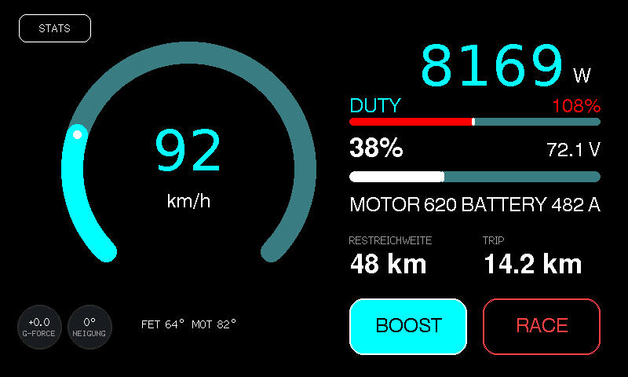
</p>

---

## 🖥️ Kompatible Displays & Hardware

Das Dashboard nutzt das extrem performante 16-Bit RGB565 Parallel-Interface und direkten Direct-Memory-Access (DMA) mit Octal PSRAM für ruckelfreie 60 FPS Grafik.

| Display / Board | Typ & Diagonale | Auflösung | Touch-Controller | Treiber / Bus | Status |
|:---|:---|:---:|:---:|:---:|:---:|
| **Waveshare ESP32-S3-Touch-LCD-4.3** | IPS RGB LCD (4.3") | 800 × 480 | Goodix GT911 (I2C) | ST7262 (16-Bit RGB) | ✅ **Referenz-Hardware** (Plug & Play) |
| **Waveshare ESP32-S3-Touch-LCD-4.3B** | IPS RGB LCD (4.3") | 800 × 480 | Goodix GT911 (I2C) | ST7262 (16-Bit RGB) | ✅ **Voll kompatibel** (identische Pinbelegung) |
| **Waveshare ESP32-S3-Touch-LCD-5** | IPS RGB LCD (5.0") | 800 × 480 | Goodix GT911 (I2C) | ST7262 (16-Bit RGB) | ✅ Kompatibel (Pin-Check in `board_config.h`) |
| **Waveshare ESP32-S3-Touch-LCD-7** | IPS RGB LCD (7.0") | 800 × 480 / 1024 × 600 | Goodix GT911 (I2C) | EK9716 / ST7262 | ⚠️ Kompatibel (Auflösung / Timings anpassen) |
| **Sunton ESP32-8048S043C / JC8048W543C** | TFT RGB LCD (4.3") | 800 × 480 | Goodix GT911 (I2C) | ST7262 / NV3047 | ✅ Kompatibel (RGB-Pins in Config zuweisen) |
| **Guition / Elecrow ESP32-S3 4.3" RGB** | IPS RGB LCD (4.3") | 800 × 480 | Goodix GT911 (I2C) | ST7262 (16-Bit RGB) | ✅ Kompatibel (RGB-Pins in Config zuweisen) |

> [!NOTE]
> **Hardware-Mindestanforderungen:**
> - **SoC:** ESP32-S3 (Dual-Core Xtensa LX7 @ 240 MHz)
> - **PSRAM:** Mindestens **8 MB Octal PSRAM (OPI)** – zwingend erforderlich für den doppelten 800×480 Framebuffer.
> - **Touch:** Kapazitiver I2C-Touchcontroller (z. B. Goodix GT911, FT6336U).
> - *Hinweis zu SPI-Displays:* Displays mit reinem SPI-Bus (z.B. 320×240) werden für dieses System nicht unterstützt, da die flüssige Vektor- und Tachonadel-Animation die hohe Bandbreite des parallelen RGB-Busses erfordert.

---

## 📸 Feature-Übersicht & Screenshots

### 1. Digitales Fahr-Cockpit
| Sport-Modus mit GPS-Uhrzeit & Satelliten-Status | Minimalistischer Modus (GPS & IMU ausgeblendet) |
|:---:|:---:|
|  | 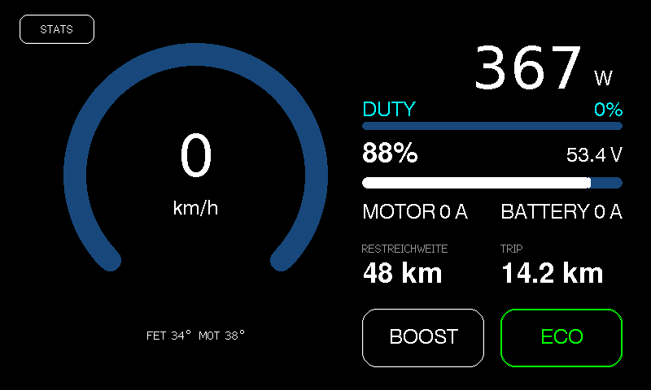 |
| **Leerlauf (Live-Uhrzeit & Rekuperation)** | **Fahrmodus-Wechsel (HUD Mode Banner)** |
|  |  |

### 2. Ersteinrichtungs-Assistent (Setup Wizard)
*Erscheint automatisch beim ersten Start nach dem Flashen oder Reset. Führt den Fahrer durch die Bedienung, ermöglicht die Vergabe eines Sicherheits-PINs (oder Überspringen) und konfiguriert die Hardware-Module.*

| Schritt 1: Schnellanleitung & Bedienung | Schritt 2: Sicherheits-PIN wählen (oder Überspringen) | Schritt 3: Hardware-Optionen & Start |
|:---:|:---:|:---:|
| 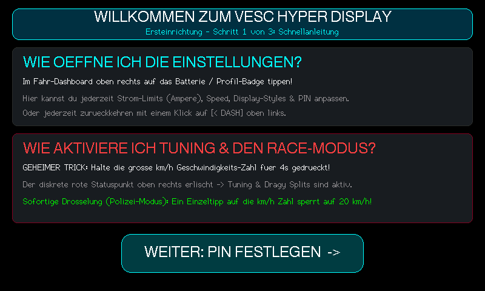 | 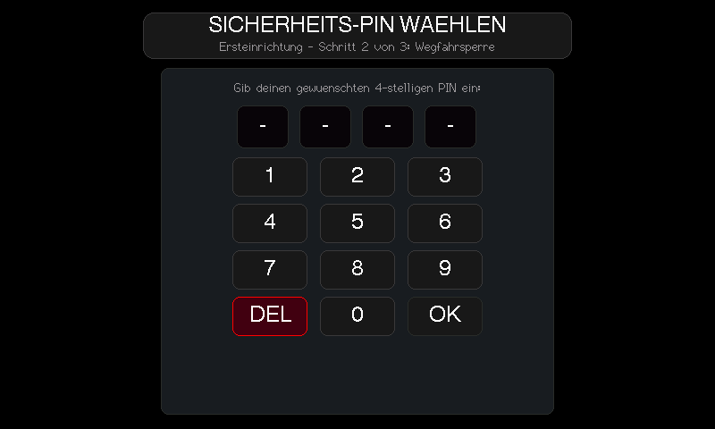 | 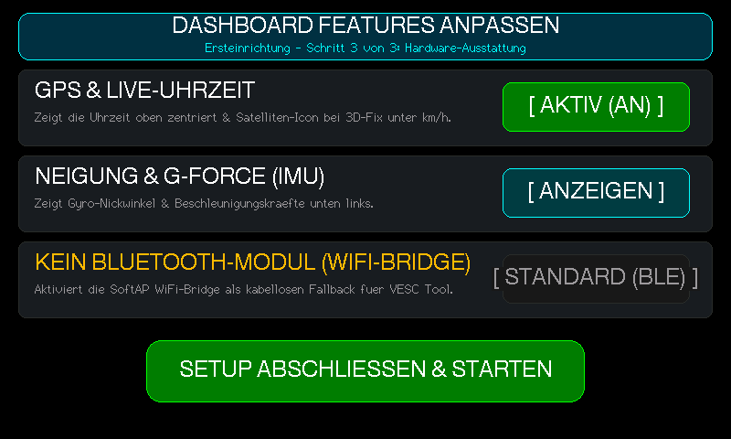 |

### 3. Dashboard-Einstellungen & Konfiguration
| Tab `[ DASH ]` (GPS-, IMU- & WiFi-Optionen) | Touch-Limits (Geschwindigkeit & Leistung Sliders) |
|:---:|:---:|
| 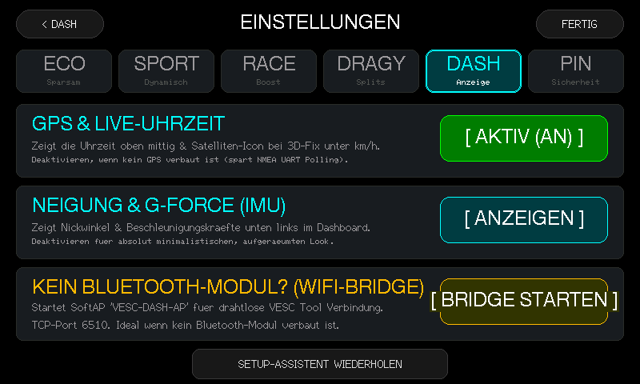 | 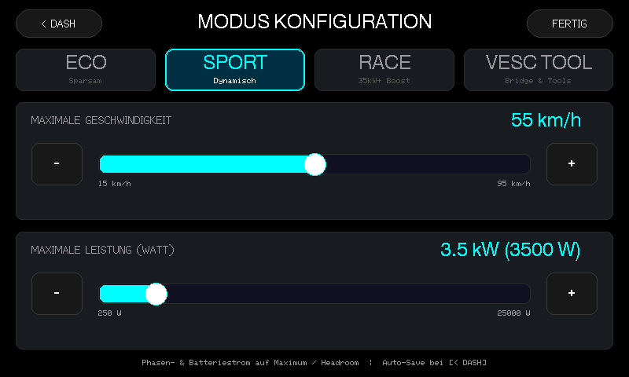 |
| **Wi-Fi Bridge (Kabelloses VESC Tool TCP Interface)** | **Dragy Split-Geschwindigkeiten Konfiguration** |
|  | 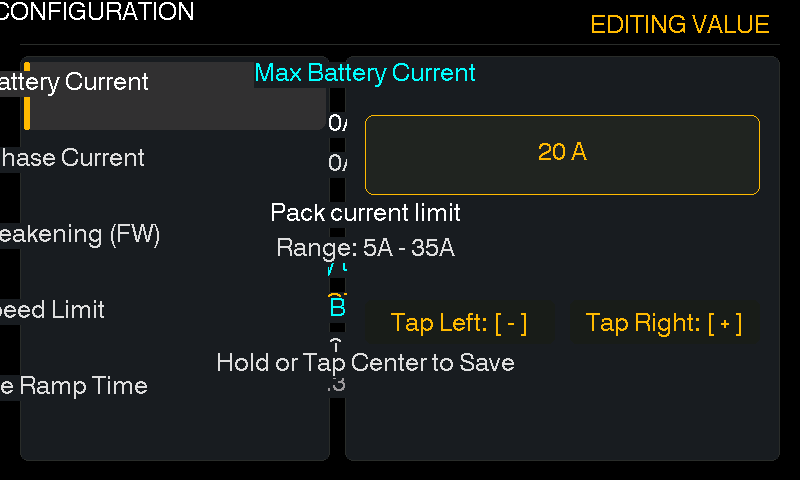 |

### 4. Beschleunigungsmessung (Dragy Launch Timer & Dyno)
| Live-Zeitmessung (z.B. 0–22, 0–50, 0–70 km/h) | Beschleunigungs-Dyno (Power & Drehmoment-Kurve) |
|:---:|:---:|
|  | 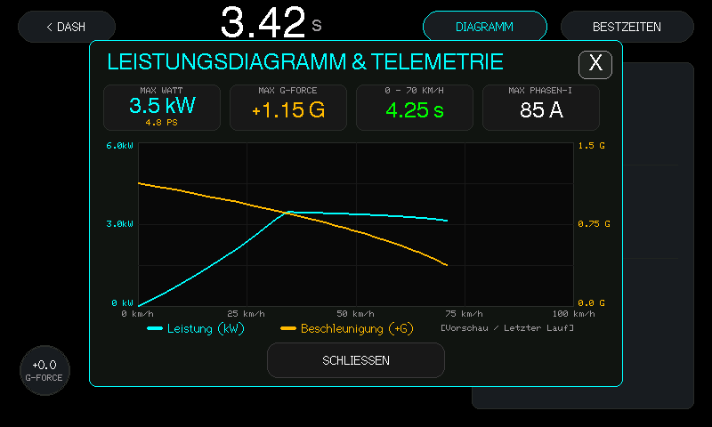 |
| **Persönliche Bestzeiten (NVS Speicher Modal)** | **Drossel-Modus (Diskreter roter Statuspunkt)** |
|  | 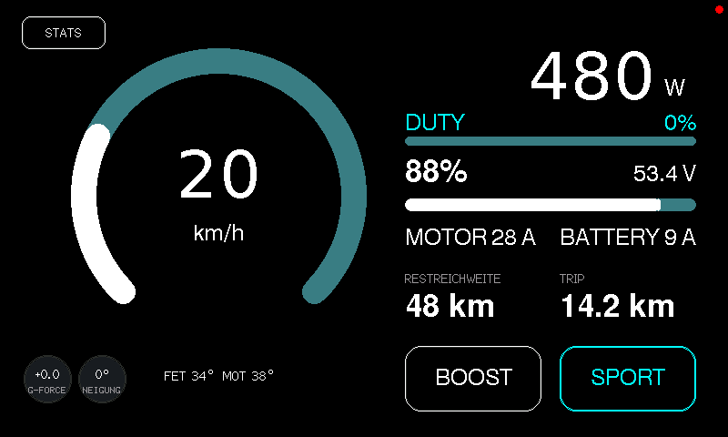 |

### 5. Sicherheit & System-Diagnose
| PIN-Wegfahrsperre beim Systemstart | VESC Fehlermeldungs-Alarmbanner |
|:---:|:---:|
|  |  |
| **Erweiterte Fahrt-Statistiken & Helligkeit** | **PIN Fehleingabe-Animation** |
|  | 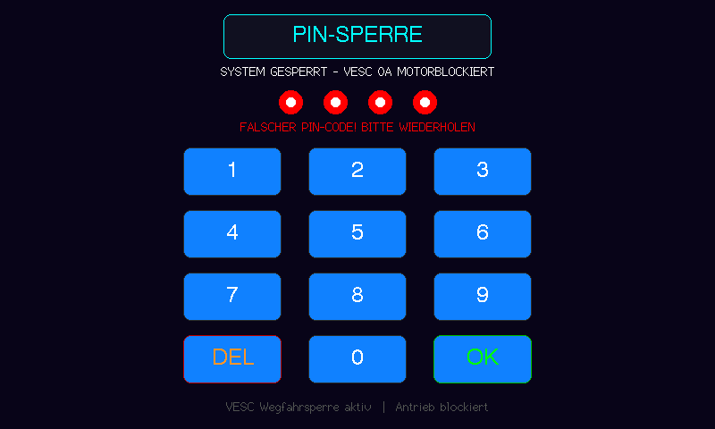 |

---

## 🚀 Kernfunktionen im Detail

### 1. Digitales Fahr-Cockpit (Screen 0)
- **High-Contrast Digitaler Tacho:**
  - Große, gut ablesbare Geschwindigkeitsanzeige mit dynamischem 270°-Bogen.
  - **Startup Needle Sweep:** Zeigertest-Animation beim Booten bzw. Entsperren (0 → 100 km/h → 0 km/h).
  - Dynamische Farbübergänge je nach Geschwindigkeit und Leistung.
  - Thermische Telemetrie direkt unter der Geschwindigkeitszahl: `FET xx°  MOT xx°`.
- **GPS-Unterstützung & Uhrzeitsynchronisation:**
  - Uhrzeit oben in der Mitte auf Höhe des `[ STATS ]`-Buttons.
  - Satelliten-Icon unter `km/h` signalisiert stabilen 3D-Fix.
  - Satellitengestützte Geschwindigkeit (schlupffrei) hat Priorität und wird an den VESC übertragen; bei Signalverlust erfolgt nahtloser Fallback auf Motor-ERPM.
- **HUD Mode Banner:**
  - Dezentes horizontales Einblend-Banner beim Umschalten der Fahrmodi (`[ ECO ]`, `[ SPORT ]`, `[ RACE ]`).
- **Bi-direktionale Leistungs- & Rekuperationsanzeige:**
  - Echte bi-direktionale Strom- und Leistungsmessung.
  - Beim Bremsen/Rekuperieren wechselt die Anzeige in Smaragdgrün mit negativem Vorzeichen (z. B. `-820 W`).
- **Batterie- & Phasenströme:**
  - Präzise SoC-% und Spannungsanzeige für Akkus von 10S bis 24S (bis 105 V).
  - Phasenstrom (`MOTOR xx A`) und Batteriestrom (`BATTERY xx A`) in Echtzeit.
  - Dynamische Restreichweitenberechnung (`RESTREICHWEITE xx km`) basierend auf rollendem Wh/km-Verbrauch.
  - Trip-Tageskilometerzähler (`TRIP xx.x km`) direkt im Cockpit.
- **Interaktive Touch-Buttons:**
  - `[ BOOST ]`: Aktiviert einen zeitlich begrenzten 120% Leistungs-Burst.
  - `[ ECO / SPORT / RACE ]`: Schaltet Profile durch.

### 2. Ersteinrichtungs-Assistent (Setup Wizard)
- **Automatischer Erststart:** Wird das System nach dem ersten Flashen gestartet (`setup_completed == false`), führt der 3-stufige Assistent durch die Basiseinstellungen:
  - **Schritt 1 (Schnellanleitung):** Erklärt das Öffnen der Einstellungen sowie die Drosselungs- und Entsperr-Gesten.
  - **Schritt 2 (PIN festlegen oder überspringen):** 4-stelligen Sicherheits-PIN vergeben oder per `[ UEBERSPRINGEN > ]` ohne Wegfahrsperre fortfahren.
  - **Schritt 3 (Hardware-Features):** Schnellwahlschalter für GPS, IMU-Neigungsanzeige und VESC-Verbindung.

### 3. Dashboard-Einstellungen (`[ DASH ]`-Tab & Parameter)
- On-Screen Einstellungsmenü mit 6 Reitern: `[ ECO ] | [ SPORT ] | [ RACE ] | [ DRAGY ] | [ DASH ] | [ PIN ]`.
- **Echtzeit-Parameteranpassung:** Geschwindigkeit (km/h) und Leistung (Watt) für jedes Profil direkt per Touch-Slider oder `[-]`/`[+]` Tasten justieren.
- **Hardware-Optionen:**
  - GPS & Live-Uhrzeit de-/aktivieren.
  - Neigungswinkel & G-Force (IMU) ein-/ausblenden.
  - VESC Wi-Fi Bridge starten (SoftAP `VESC-DASH-AP` auf Port 6510 für kabellose VESC-Tool Verbindung).
  - Setup-Assistenten jederzeit erneut starten.

### 4. Dragy Launch Control & Beschleunigungsmessung
- **5-Sekunden Launch Countdown:** Optische Ampel mit präziser Zwischenzeiterfassung (z. B. 0–22 km/h, 0–50 km/h, 0–70 km/h).
- **Automatischer Rekordspeicher:** Neue Bestzeiten werden als `*PB*` markiert und dauerhaft im NVS gespeichert.
- **Live-Dyno Modal:** Zeichnet Drehmoment- und Leistungsverlauf über der Zeit auf.
- **Thermischer Launch-Schutz:** Blockiert Starts bei Controller- oder Motortemperaturen über 65 °C.

### 5. PIN-Wegfahrsperre & System-Sicherheit
- 4-stellige Code-Abfrage beim Einschalten mit 0A Stromabschaltung zum VESC.
- Kann bei Bedarf komplett deaktiviert oder jederzeit in den Einstellungen geändert werden.
- Notfall-Reset über definierte Service-Geste.

### 6. VESC Fehler-Diagnose & Blackbox
- Echtzeit-Dekodierung von VESC-Fehlercodes (`mc_fault_code`: Übertemperatur, Überspannung, Gate-Treiber-Fehler etc.).
- Alarm-Banner auf dem Bildschirm und permanenter Ringspeicher für die letzten 10 Fehler im NVS.

---

## 👆 Touch-Gesten & Bedienung

| Geste / Bereich | Bildschirm | Funktion |
|---|---|---|
| **Swipe Links** ($\Delta X < -60\text{px}$) | Fahr-Cockpit | Zu Statistiken & Telemetrie-Graphen wechseln |
| **Swipe Rechts** ($\Delta X > +60\text{px}$) | Telemetrie-Graphen | Zurück zum Fahr-Cockpit |
| **Tipp `[ STATS ]`** (Oben links) | Fahr-Cockpit | Öffnet Statistik- & Helligkeitsmenü |
| **Tipp `[ < DASH ]`** (Oben links) | Untermenüs / Settings | Direkte Rückkehr ins Haupt-Cockpit |
| **Tipp `[ RACE ]`** (Oben links) | Statistiken (nur bei Tuning) | Öffnet Dragy Beschleunigungs-Timer |
| **Tipp `[ BESTZEITEN ]` / `[ DIAGRAMM ]`** | Race Screen | Öffnet Bestzeiten-Popup bzw. Beschleunigungs-Kurve |
| **Tipp `[ BOOST ]`** | Fahr-Cockpit | Aktiviert 10-Sekunden Boost |
| **Tipp `[ ECO / SPORT / RACE ]`** | Fahr-Cockpit | Schaltet Fahrmodus um |
| **Tipp Batterie-Badge** (Oben rechts) | Fahr-Cockpit | Öffnet Einstellungsmenü |
| **Halten auf Geschwindigkeitszahl (4s)** | Fahr-Cockpit | **Tuning-Modus aktivieren / deaktivieren** |
| **Einzeltipp auf Geschwindigkeitszahl** | Fahr-Cockpit (aktiviert) | **Sofortige Drosselung auf 20 km/h (Polizei-Modus)** |
| **Langer Druck unten links** | Fahr-Cockpit / Stats | Tageskilometerzähler (Trip) & Peak-Werte auf 0 zurücksetzen |

---

## 🔌 Hardware-Verkabelung

### 1. Display Pinbelegung (Waveshare ESP32-S3-Touch-LCD-4.3)
- **Display-Treiber:** ST7262 RGB Parallel Interface (800 × 480 @ 14 MHz PCLK)
- **Sync-Leitungen:** HSYNC = GPIO 46, VSYNC = GPIO 3, DE = GPIO 5, PCLK = GPIO 7
- **16-Bit RGB565:**
  - Blau (B0–B4): GPIO 14, 38, 18, 17, 10
  - Grün (G0–G5): GPIO 39, 0, 45, 48, 47, 21
  - Rot (R0–R4): GPIO 1, 2, 42, 41, 40
- **Touch:** Goodix GT911 (I2C SDA = GPIO 8, SCL = GPIO 9, INT = GPIO 4)
- **IO-Expander:** CH422G (I2C `0x24`), EXIO2 steuert die Display-Hintergrundbeleuchtung

### 2. VESC-Verbindung (CAN-Bus oder UART)
Die Verbindung erfolgt wahlweise über **CAN-Bus** (empfohlen) oder **UART**. Umschaltbar in [`include/board_config.h`](include/board_config.h):
```c
#define VESC_USE_CAN_BUS 1   // 1 = High-Speed CAN Bus (500 kbps), 0 = UART (115200)
```

#### CAN-Bus Verkabelung (Empfohlen)
Nutzt den integrierten TJA1051 CAN-Transceiver des Displays:
| Display Klemme | VESC CAN Port | Funktion |
|:---|:---|:---|
| **5V / VCC** | `5V` | Stromversorgung vom internen 5V BEC des VESC |
| **GND** | `GND` | Gemeinsame Masse |
| **CAN_H** | `CAN_H` | CAN High (500 kbps) |
| **CAN_L** | `CAN_L` | CAN Low (500 kbps) |

> [!TIP]
> Bei Nutzung von CAN-Bus bleibt der `COMM / UART`-Port des VESC frei für Bluetooth-Module oder Zubehör.

#### UART Verkabelung (Alternative)
| Display Pin | VESC COMM Port | Funktion |
|:---|:---|:---|
| **5V / VCC** | `5V` | Stromversorgung |
| **GND** | `GND` | Gemeinsame Masse |
| **TX (GPIO 43)** | `RX` | Senden (115200 Baud) |
| **RX (GPIO 44)** | `TX` | Empfangen (115200 Baud) |

### 3. GPS / BDS GNSS Modul (z. B. ATGM336H / NEO-M8N)
- **GPS TX** $\rightarrow$ **ESP32 RX** (GPIO 44 im CAN-Modus)
- **GPS RX** $\rightarrow$ **ESP32 TX** (GPIO 43 im CAN-Modus)
- **VCC (3.3V / 5V)** und **GND**

---

## 💻 Simulator & Live-Entwicklung

Das Repository enthält einen nativen Desktop-Simulator mit integriertem VESC-Protokoll-Emulator:

```bash
# Live-Demo mit grafischem Fenster & Web-Stream starten
DISPLAY=:0 python3 tools/simulator/live_demo.py
```
- **Web-Interface:** [http://localhost:8080](http://localhost:8080) (60 FPS interaktiver Stream mit Touch-Unterstützung).
- **VESC Tool TCP Server:** TCP-Port `6510` zum direkten Testen mit dem offiziellen VESC Tool.
- **Automatische Unittests & Screenshot-Suite:**
```bash
./tools/simulator/build_and_run.sh
```

---

## ⚡ Flashen auf das Board

1. Waveshare ESP32-S3 Board per USB-C mit dem PC verbinden.
2. In [`include/board_config.h`](include/board_config.h) `#define SIMULATION_MODE 0` setzen.
3. Firmware mit PlatformIO bauen und übertragen:
```bash
pio run -t upload
```

---

## 📄 Lizenz
MIT License. Frei nutzbar für private und kommerzielle Projekte.
