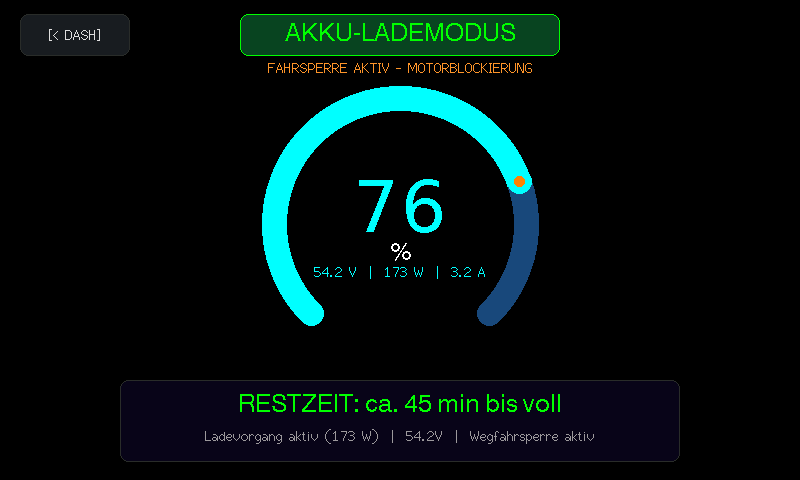
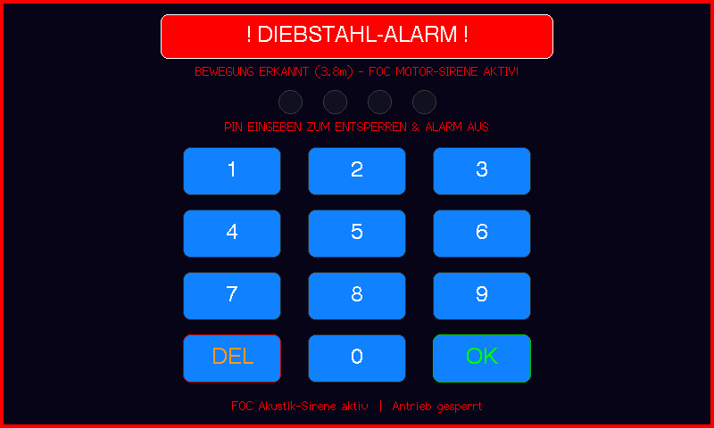

# VESC - Touch Display (800x480) - Waveshare ESP32-S3

Professionelles, autarkes digitales Kombiinstrument und Touch-Dashboard für VESC-basierte Elektrofahrzeuge (E-Scooter, E-Bikes, Go-Karts, LEVs), optimiert für das **Waveshare ESP32-S3-Touch-LCD-4.3** (800×480 RGB LCD, Goodix GT911 kapazitiver Touch, 16MB Flash, 8MB Octal PSRAM).

<p align="center">
  
</p>

---

## 🖥️ Kompatible Displays & Hardware

Das Dashboard nutzt das extrem performante 16-Bit RGB565 Parallel-Interface und direkten Direct-Memory-Access (DMA) mit Octal PSRAM für ruckelfreie 60 FPS Grafik.

| Display / Board | Typ & Diagonale | Auflösung | Touch-Controller | Treiber / Bus | Status |
|:---|:---|:---:|:---:|:---:|:---:|
| **Waveshare ESP32-S3-Touch-LCD-4.3** | IPS RGB LCD (4.3") | 800 × 480 | Goodix GT911 (I2C) | ST7262 (16-Bit RGB) | ✅ **Referenz-Hardware** (Plug & Play) |
| **Waveshare ESP32-S3-Touch-LCD-4.3B** | IPS RGB LCD (4.3") | 800 × 480 | Goodix GT911 (I2C) | ST7262 (16-Bit RGB) | ✅ **Voll kompatibel** (identische Pinbelegung) |
| **Waveshare ESP32-S3-Touch-LCD-5** | IPS RGB LCD (5.0") | 800 × 480 | Goodix GT911 (I2C) | ST7262 (16-Bit RGB) | ✅ Kompatibel (Pin-Check in `board_config.h`) |
| **Waveshare ESP32-S3-Touch-LCD-7** | IPS RGB LCD (7.0") | 800 × 480 / 1024 × 600 | Goodix GT911 (I2C) | EK9716 / ST7262 | ⚠️ Kompatibel (Auflösung / Timings anpassen) |
| **Sunton ESP32-8048S043C / JC8048W543C** | TFT RGB LCD (4.3") | 800 × 480 | Goodix GT911 (I2C) | ST7262 / NV3047 | ✅ Kompatibel (RGB-Pins in Config zuweisen) |
| **Guition / Elecrow ESP32-S3 4.3" RGB** | IPS RGB LCD (4.3") | 800 × 480 | Goodix GT911 (I2C) | ST7262 (16-Bit RGB) | ✅ Kompatibel (RGB-Pins in Config zuweisen) |

> [!NOTE]
> **Hardware-Mindestanforderungen:**
> - **SoC:** ESP32-S3 (Dual-Core Xtensa LX7 @ 240 MHz)
> - **PSRAM:** Mindestens **8 MB Octal PSRAM (OPI)** – zwingend erforderlich für den doppelten 800×480 Framebuffer.
> - **Touch:** Kapazitiver I2C-Touchcontroller (z. B. Goodix GT911, FT6336U).
> - *Hinweis zu SPI-Displays:* Displays mit reinem SPI-Bus (z.B. 320×240) werden für dieses System nicht unterstützt, da die flüssige Vektor- und Tachonadel-Animation die hohe Bandbreite des parallelen RGB-Busses erfordert.

---

## 📸 Feature-Übersicht & Screenshots

### 1. Digitales Fahr-Cockpit
| Sport-Modus mit GPS-Uhrzeit & Satelliten-Status | Minimalistischer Modus (GPS & IMU ausgeblendet) |
|:---:|:---:|
|  |  |
| **Leerlauf (Live-Uhrzeit & Rekuperation)** | **Fahrmodus-Wechsel (HUD Mode Banner)** |
|  |  |

### 2. Ersteinrichtungs-Assistent (Setup Wizard)
*Erscheint automatisch beim ersten Start nach dem Flashen oder Reset. Führt den Fahrer durch die Bedienung, ermöglicht die Vergabe eines Sicherheits-PINs (oder Überspringen) und konfiguriert die Hardware-Module.*

| Schritt 1: Schnellanleitung & Bedienung | Schritt 2: Sicherheits-PIN wählen (oder Überspringen) | Schritt 3: Hardware-Optionen & Start |
|:---:|:---:|:---:|
|  |  |  |

### 3. Dashboard-Einstellungen & Konfiguration
| Tab `[ DASH ]` (GPS-, IMU- & WiFi-Optionen) | Touch-Limits (Geschwindigkeit & Leistung Sliders) |
|:---:|:---:|
|  |  |
| **Wi-Fi Bridge (Kabelloses VESC Tool TCP Interface)** | **Dragy Split-Geschwindigkeiten Konfiguration** |
|  |  |

### 4. Beschleunigungsmessung (Dragy Launch Timer & Dyno)
| Live-Zeitmessung (z.B. 0–22, 0–50, 0–70 km/h) | Beschleunigungs-Dyno (Power & Drehmoment-Kurve) |
|:---:|:---:|
|  |  |
| **Persönliche Bestzeiten (NVS Speicher Modal)** | **Drossel-Modus (Diskreter roter Statuspunkt)** |
|  |  |

### 5. Sicherheit & System-Diagnose
| PIN-Wegfahrsperre beim Systemstart | VESC Fehlermeldungs-Alarmbanner |
|:---:|:---:|
|  |  |
| **Erweiterte Fahrt-Statistiken & Helligkeit** | **PIN Fehleingabe-Animation** |
|  |  |

### 6. Intelligenter Akku-Lademodus & Diebstahlschutz
| Akku-Lademodus mit Restzeit-Anzeige & Wegfahrsperre | Diebstahlschutz mit VESC FOC Motor-Sirene |
|:---:|:---:|
|  |  |

---

## 🌟 Spannende Features & Highlights

- ⚡ **Intelligenter Akku-Lademodus (Charging HUD):**
  - **Vollautomatische Erkennung:** Erkennt das Anstecken des Ladegeräts im Stillstand anhand von Ladestrom oder Spannungsanstieg sofort und schaltet eigenständig auf das Lade-HUD um.
  - **Tacho-Ladekreis & Restzeit:** Eleganter 270°-Bogen mit großem Akkustand (%) im Zentrum, Live-Anzeige von Ladeleistung (Watt), Spannung (Volt) und Strom (Ampere) sowie dynamisch hochgerechneter Restladezeit (`RESTZEIT: ca. X min bis voll`).
  - **Hardware-Wegfahrsperre:** Während des Ladevorgangs wird der VESC-Motorstrom auf 0 A gekappt – Fahren oder versehentliches Gasgeben bei eingestecktem Kabel ist unmöglich. Nach dem Abstecken wird der vorherige Bildschirm automatisch wiederhergestellt.

- 🚨 **Diebstahlschutz mit VESC FOC Motor-Sirene:**
  - **Bewegungserkennung im Lock-Zustand:** Wird das gesperrte Fahrzeug mehr als 2 Meter bewegt (gemessen über Motor-ERPM, GPS oder Gyro), schlägt das System Alarm.
  - **Motor als Sirene:** Nutzt Benjamin Vedders FOC-Audio-Modulation (`foc-beep`) direkt über die Motorwicklungen – extrem laut und durchdringend, ganz ohne externen Summer oder Lautsprecher!
  - **Visueller Alarm-Screen:** Der Bildschirm blinkt rot mit Entfernungsanzeige und akustischer Warnung. Nur die Eingabe des korrekten PINs entschärft die Sirene und gibt den Antrieb wieder frei.

- 👮 **One-Touch Polizei- & Drossel-Modus (Stealth Lock):**
  - **Sekundenschnelle Drosselung:** Ein einfacher Fingertipp auf die km/h-Anzeige riegelt das Fahrzeug sofort unumkehrbar auf 20 km/h (bzw. konfigurierte Werte) ab.
  - **Diskreter Statuspunkt:** Ein winziger roter Subpixel-Punkt oben rechts im Eck signalisiert dem Fahrer unauffällig den Drosselstatus (im offenen Tuning-Modus unsichtbar).
  - **Geheimer Entsperr-Druck:** Das Umschalten in den offenen Tuning-Modus ist gegen versehentliches Auslösen gesichert und erfordert einen verdeckten 4-Sekunden-Druck auf die Geschwindigkeitszahl.

- ⏱️ **Dragy Launch Control & Beschleunigungs-Dyno:**
  - **Präzise 0–x km/h Messung:** Professionelle Beschleunigungsmessung mit optischer Ampel (5s Countdown) und automatischer Erfassung von Split-Zeiten (z. B. 0–22, 0–50, 0–70 km/h).
  - **Persönliche Bestzeiten:** Neue Rekorde werden automatisch mit Sternchen (`*PB*`) markiert und im Flash-Speicher (NVS) dauerhaft gespeichert.
  - **Live-Dyno Diagramm:** Integrierte Leistungs- und Drehmomentkurve visualisiert den Beschleunigungsverlauf direkt auf dem Touchscreen.

- 📶 **Kabellose VESC Wi-Fi Bridge:**
  - Startet per Knopfdruck einen lokalen WLAN-Hotspot (`VESC-DASH-AP`).
  - Überträgt VESC-Telemetriedaten und Einstellungen transparent über TCP (Port 6510) – verbinde einfach das offizielle **VESC Tool** auf Smartphone oder PC, um Motorparameter drahtlos live abzustimmen.

- 🧙 **Ersteinrichtungs-Assistent & PIN-Wegfahrsperre:**
  - Automatischer 3-Schritte-Setup-Wizard beim Erststart.
  - 4-stelliger PIN schützt vor unbefugter Nutzung (kann im Assistenten mit einem Klick auf `[ UEBERSPRINGEN > ]` auch abgewählt werden).
  - 5-Sekunden-Notfall-Reset-Geste für den Fall eines vergessenen Codes.

- 🎛️ **On-Screen Live-Settings (km/h & Watt):**
  - Geschwindigkeit und Maximalleistung können für jeden Fahrmodus (`ECO`, `SPORT`, `RACE`) bequem am Touchscreen per Schieberegler oder `[-]`/`[+]`-Tasten angepasst werden – ganz ohne VESC Tool oder Programmierkenntnisse.

- 🎨 **5 Wählbare Farb-Sets (Themes):**
  - **Cyber Cyan** (Standard), **Synthwave Outrun**, **Toxic Green**, **Racing Red** und **Clean Ice**.
  - Passen das gesamte Cockpit (Tacho-Bogen, Spuren, Akku-Leiste, Akzentfarben) dem individuellen Fahrzeugstil an.
  - Umschaltbar über Tab 4 (`DASH`) im Einstellungsmenü oder im Simulator (Taste `T`), dauerhaft im NVS gespeichert.

- 🚀 **FOC-Audio Triebwerkssound (Jet Engine Whine):**
  - Moduliert während der Fahrt einen dynamischen Turbinensound direkt über die Motorwicklungen mittels VESC FOC Audio (`foc-play-tone`).
  - **Lauter & höher desto schneller:** Tonhöhe (280 Hz bis 3200 Hz) und Lautstärke (1.2V bis 6.5V) skalieren fließend mit der Geschwindigkeit.
  - **Strikte Null-Interferenz:** Die akustische Schwingung erzeugt kein Nettodrehmoment – Fahrphysik, Gasannahme, Rekuperation und Schutzlimits bleiben zu 100% unberührt! Im Stillstand sofort lautlos.

---

## 👆 Touch-Gesten & Bedienung

Das gesamte System ist für schnelle, intuitive Bedienung mit Handschuhen während der Fahrt optimiert:

### 🟢 Im Fahrbetrieb (Haupt-Cockpit)
| Aktion | Touch-Geste / Bereich | Funktion |
|:---|:---|:---|
| **Fahrmodus wechseln** | Tipp auf `[ ECO / SPORT / RACE ]` (unten Mitte) | Schaltet zwischen den 3 Profilen um (HUD-Banner zeigt Wechsel) |
| **Boost aktivieren** | Tipp auf `[ BOOST ]` (unten rechts) | Aktiviert für 10 Sekunden maximalen Leistungs-Boost |
| **Statistiken / Graphen** | Wisch nach **Links** ($\leftarrow$) oder Tipp `[ STATS ]` | Öffnet Fahr-Statistiken, Wh/km und Live-Graphen |
| **Trip zurücksetzen** | Langer Druck (2s) unten links auf den Trip-Zähler | Setzt Tageskilometer (`TRIP km`) und Spitzenwerte auf 0 |
| **Einstellungen öffnen** | Tipp auf das Batterie-Badge (oben rechts) | Öffnet das Einstellungsmenü für Limits und Display-Optionen |

### 🔒 Sicherheit & Drosselung (Polizei-Modus)
| Aktion | Touch-Geste / Bereich | Funktion |
|:---|:---|:---|
| **Sofort-Drossel (20 km/h)** | **1x Tipp auf die mittlere Geschwindigkeitszahl** | Verriegelt den Scooter blitzschnell auf 20 km/h (roter Statuspunkt erscheint) |
| **Tuning entsperren** | **4 Sekunden gedrückt halten auf die km/h-Zahl** | Schaltet offene Leistung und Höchstgeschwindigkeit wieder frei |
| **PIN-Wegfahrsperre** | PIN auf dem On-Screen Keypad eingeben | Entsperrt das Fahrzeug beim Booten oder schaltet Diebstahl-Alarm aus |
| **Notfall PIN-Reset** | 5 Sekunden Dauerdruck auf den PIN-Sperrbildschirm | Notfall-Rücksetzung des PINs auf Werkseinstellung (`1234`) |

### 🧭 Navigation & Untermenüs
| Aktion | Touch-Geste / Bereich | Funktion |
|:---|:---|:---|
| **Zurück zum Dashboard** | Tipp auf `[ < DASH ]` (oben links) | Kehrt aus jedem Menü, Race-Timer oder Lade-HUD sofort zum Cockpit zurück |
| **Helligkeit anpassen** | Schieberegler oder `[-]` / `[+]` auf dem Stats-Screen | Displayhelligkeit stufenlos zwischen 20 % und 100 % regeln |
| **Dragy Race starten** | Tipp auf `[ RACE ]` (Stats-Screen, nur bei Tuning) | Öffnet den Beschleunigungs-Timer mit 5s Launch Control |
| **Parameter anpassen** | Slider / `[-]` / `[+]` in den Einstellungen | Geschwindigkeits- (km/h) und Leistungslimits (Watt) direkt verstellen |

---

## 🔌 Hardware-Verkabelung

### 1. Display Pinbelegung (Waveshare ESP32-S3-Touch-LCD-4.3)
- **Display-Treiber:** ST7262 RGB Parallel Interface (800 × 480 @ 14 MHz PCLK)
- **Sync-Leitungen:** HSYNC = GPIO 46, VSYNC = GPIO 3, DE = GPIO 5, PCLK = GPIO 7
- **16-Bit RGB565:**
  - Blau (B0–B4): GPIO 14, 38, 18, 17, 10
  - Grün (G0–G5): GPIO 39, 0, 45, 48, 47, 21
  - Rot (R0–R4): GPIO 1, 2, 42, 41, 40
- **Touch:** Goodix GT911 (I2C SDA = GPIO 8, SCL = GPIO 9, INT = GPIO 4)
- **IO-Expander:** CH422G (I2C `0x24`), EXIO2 steuert die Display-Hintergrundbeleuchtung

### 2. VESC-Verbindung (CAN-Bus oder UART)
Die Verbindung erfolgt wahlweise über **CAN-Bus** (empfohlen) oder **UART**. Umschaltbar in [`include/board_config.h`](include/board_config.h):
```c
#define VESC_USE_CAN_BUS 1   // 1 = High-Speed CAN Bus (500 kbps), 0 = UART (115200)
```

#### CAN-Bus Verkabelung (Empfohlen)
Nutzt den integrierten TJA1051 CAN-Transceiver des Displays:
| Display Klemme | VESC CAN Port | Funktion |
|:---|:---|:---|
| **5V / VCC** | `5V` | Stromversorgung vom internen 5V BEC des VESC |
| **GND** | `GND` | Gemeinsame Masse |
| **CAN_H** | `CAN_H` | CAN High (500 kbps) |
| **CAN_L** | `CAN_L` | CAN Low (500 kbps) |

> [!TIP]
> Bei Nutzung von CAN-Bus bleibt der `COMM / UART`-Port des VESC frei für Bluetooth-Module oder Zubehör.

#### UART Verkabelung (Alternative)
| Display Pin | VESC COMM Port | Funktion |
|:---|:---|:---|
| **5V / VCC** | `5V` | Stromversorgung |
| **GND** | `GND` | Gemeinsame Masse |
| **TX (GPIO 43)** | `RX` | Senden (115200 Baud) |
| **RX (GPIO 44)** | `TX` | Empfangen (115200 Baud) |

### 3. GPS / BDS GNSS Modul (z. B. ATGM336H / NEO-M8N)
- **GPS TX** $\rightarrow$ **ESP32 RX** (GPIO 44 im CAN-Modus)
- **GPS RX** $\rightarrow$ **ESP32 TX** (GPIO 43 im CAN-Modus)
- **VCC (3.3V / 5V)** und **GND**

---

## 💻 Simulator & Live-Entwicklung

Das Repository enthält einen nativen Desktop-Simulator mit integriertem VESC-Protokoll-Emulator:

```bash
# Live-Demo mit grafischem Fenster & Web-Stream starten
DISPLAY=:0 python3 tools/simulator/live_demo.py
```
- **Web-Interface:** [http://localhost:8080](http://localhost:8080) (60 FPS interaktiver Stream mit Touch-Unterstützung).
- **VESC Tool TCP Server:** TCP-Port `6510` zum direkten Testen mit dem offiziellen VESC Tool.
- **Automatische Unittests & Screenshot-Suite:**
```bash
./tools/simulator/build_and_run.sh
```

---

## ⚡ Flashen auf das Board (Schritt-für-Schritt)

### 1. Voraussetzungen
- **Hardware:** Waveshare ESP32-S3-Touch-LCD-4.3 (oder kompatibles RGB-Board aus der Liste).
- **Kabel:** Hochwertiges USB-C Datenkabel (am USB-Port des ESP32-S3 Boards angeschlossen, nicht am reinen UART-Port).
- **Software:** 
  - [PlatformIO Core (CLI)](https://platformio.org/install/cli) oder **VS Code** mit installierter **PlatformIO IDE** Extension.
  - Python 3.9+ installiert.

### 2. Konfiguration vor dem Flashen
Öffne [`include/board_config.h`](include/board_config.h) und prüfe folgende Grundeinstellungen:
```c
// 1 = Echte Hardware (ESP32-S3), 0 = Desktop-Simulator
#define SIMULATION_MODE 0

// 1 = CAN-Bus (500 kbps, empfohlen), 0 = UART (115200 Baud)
#define VESC_USE_CAN_BUS 1

// Fahrzeug-Parameter für exakte Geschwindigkeits- und Distanzberechnung:
#define WHEEL_DIAMETER_INCH   10.0f   // Reifendurchmesser in Zoll (z. B. 10.0" oder 11.0")
#define MOTOR_POLE_PAIRS      15      // Polpaare des Motors (Standard: 15 für Hub-Motoren)
#define GEAR_RATIO            1.0f    // 1.0 bei Direktantrieb / Hub-Motor
```

### 3. Linux-Nutzer: USB-Zugriffsrechte setzen
Unter Linux benötigt PlatformIO Schreibrechte auf die serielle USB-Schnittstelle (`/dev/ttyACM*`):
```bash
# Benutzer zur dialout-Gruppe hinzufügen:
sudo usermod -a -G dialout $USER

# Alternativ temporär Schreibrechte auf den Port vergeben:
sudo chmod 666 /dev/ttyACM*
```
*(Nach dem Gruppen-Befehl einmal ab- und wieder anmelden)*

### 4. Kompilieren & Flashen
Verbinde das Board per USB-C mit dem PC und starte den Build & Flash-Prozess:

```bash
# Firmware kompilieren und direkt auf den ESP32-S3 übertragen:
pio run -t upload
```

> [!TIP]
> **Board wird nicht erkannt oder hängt bei `Connecting... ___...___`?**  
> Bring das Board manuell in den ESP32-S3 Bootloader-Modus:
> 1. Die **BOOT-Taste** auf dem Board gedrückt halten.
> 2. Die **RESET-Taste** kurz drücken.
> 3. Die **BOOT-Taste** loslassen.
> 4. `pio run -t upload` erneut ausführen.

### 5. Serieller Monitor & Erster Start
Starte nach dem Flashen den seriellen Monitor, um Telemetrie- und VESC-Logs einzusehen:
```bash
pio device monitor -b 115200
```
- Beim allerersten Start startet das Display automatisch den **Ersteinrichtungs-Assistenten** (Setup Wizard).
- Folge den 3 Schritten auf dem Touchscreen (Schnellanleitung $\rightarrow$ PIN-Wahl $\rightarrow$ Hardware-Optionen) – schon ist das Cockpit fahrbereit!

---

## 📄 Lizenz
MIT License. Frei nutzbar für private und kommerzielle Projekte.
