# VESC - Touch Display (800x480) - Waveshare ESP32-S3

Professionelles, autarkes digitales Kombiinstrument und Touch-Dashboard für VESC-basierte Elektrofahrzeuge (E-Scooter, E-Bikes, Go-Karts, LEVs), optimiert für das **Waveshare ESP32-S3-Touch-LCD-4.3** (800×480 RGB LCD, Goodix GT911 kapazitiver Touch, 16MB Flash, 8MB Octal PSRAM).

<p align="center">
  
</p>

---

## 🖥️ Kompatible Displays & Hardware

Das Dashboard nutzt das extrem performante 16-Bit RGB565 Parallel-Interface mit **800×480 PSRAM Off-Screen-Backbuffer**, selektivem Dirty-Rect-Blitting (`pushRect`) und harmonisierten ST7262-Timings (`12 MHz` PCLK, exakter 240 MHz / 20 Integer-Teiler) für 100 % flackerfreie Grafik ohne schwarzes Aufblitzen.

| Display / Board | Typ & Diagonale | Auflösung | Touch-Controller | Treiber / Bus | Status |
|:---|:---|:---:|:---:|:---:|:---:|
| **Waveshare ESP32-S3-Touch-LCD-4.3** | IPS RGB LCD (4.3") | 800 × 480 | Goodix GT911 (I2C) | ST7262 (16-Bit RGB) | ✅ **Referenz-Hardware** (Plug & Play) |
| **Waveshare ESP32-S3-Touch-LCD-4.3B** | IPS RGB LCD (4.3") | 800 × 480 | Goodix GT911 (I2C) | ST7262 (16-Bit RGB) | ✅ **Voll kompatibel** (identische Pinbelegung) |
| **Waveshare ESP32-S3-Touch-LCD-5** | IPS RGB LCD (5.0") | 800 × 480 | Goodix GT911 (I2C) | ST7262 (16-Bit RGB) | ✅ Kompatibel (Pin-Check in `board_config.h`) |
| **Waveshare ESP32-S3-Touch-LCD-7** | IPS RGB LCD (7.0") | 800 × 480 | Goodix GT911 (I2C) | ST7262 (16-Bit RGB) | ✅ **Voll kompatibel** (harmonisierte 4.3"/7"-Timings) |
| **Sunton ESP32-8048S043C / JC8048W543C** | TFT RGB LCD (4.3") | 800 × 480 | Goodix GT911 (I2C) | ST7262 / NV3047 | ✅ Kompatibel (RGB-Pins in Config zuweisen) |
| **Guition / Elecrow ESP32-S3 4.3" RGB** | IPS RGB LCD (4.3") | 800 × 480 | Goodix GT911 (I2C) | ST7262 (16-Bit RGB) | ✅ Kompatibel (RGB-Pins in Config zuweisen) |

> [!NOTE]
> **Hardware-Mindestanforderungen:**
> - **SoC:** ESP32-S3 (Dual-Core Xtensa LX7 @ 240 MHz)
> - **PSRAM:** Mindestens **8 MB Octal PSRAM (OPI)** – zwingend erforderlich für den doppelten 800×480 Framebuffer.
> - **Touch:** Kapazitiver I2C-Touchcontroller (z. B. Goodix GT911, FT6336U).
> - *Hinweis zu SPI-Displays:* Displays mit reinem SPI-Bus (z.B. 320×240) werden für dieses System nicht unterstützt, da die flüssige Vektor- und Tachonadel-Animation die hohe Bandbreite des parallelen RGB-Busses erfordert.

---

## 📸 Feature-Übersicht & Screenshots

### 1. Digitales Fahr-Cockpit
| Sport-Modus mit GPS-Uhrzeit & Satelliten-Status | Minimalistischer Modus (GPS & IMU ausgeblendet) |
|:---:|:---:|
|  | 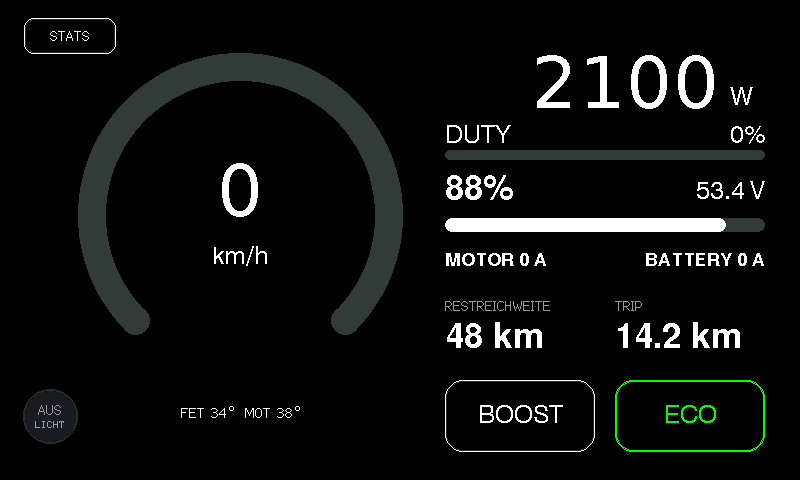 |
| **Leerlauf (Live-Uhrzeit & Rekuperation)** | **Fahrmodus-Wechsel (HUD Mode Banner)** |
| 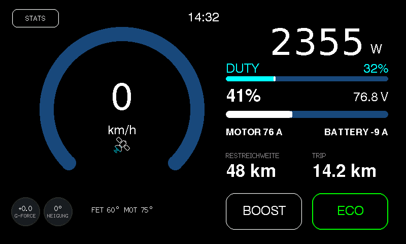 | 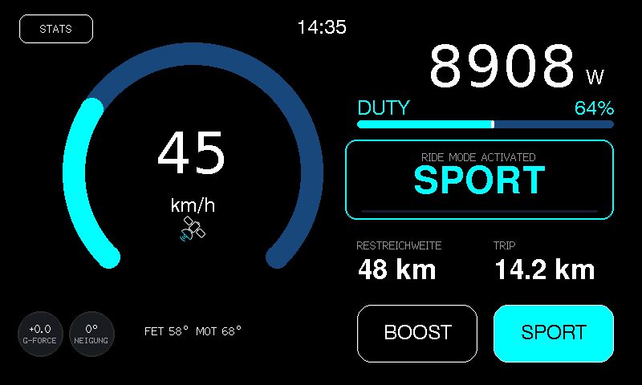 |

### 2. Ersteinrichtungs-Assistent (Setup Wizard)
*Erscheint automatisch beim ersten Start nach dem Flashen oder Reset. Führt den Fahrer durch die Bedienung, ermöglicht die Vergabe eines Sicherheits-PINs (oder Überspringen) und konfiguriert die Hardware-Module.*

| Schritt 1: Schnellanleitung & Bedienung | Schritt 2: Sicherheits-PIN wählen (oder Überspringen) | Schritt 3: Hardware-Optionen & Start |
|:---:|:---:|:---:|
| 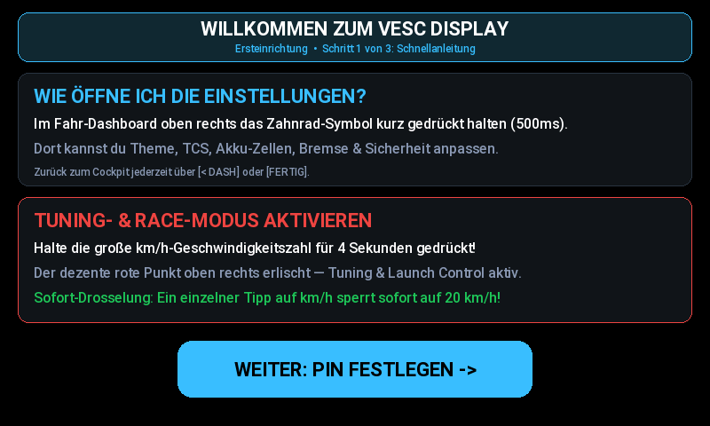 |  | 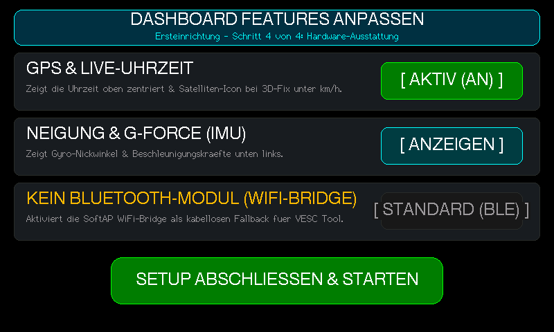 |

### 3. Dashboard-Einstellungen & Konfiguration
| Tab `[ DASH ]` (GPS-, IMU- & WiFi-Optionen) | Touch-Limits (Geschwindigkeit & Leistung Sliders) |
|:---:|:---:|
| 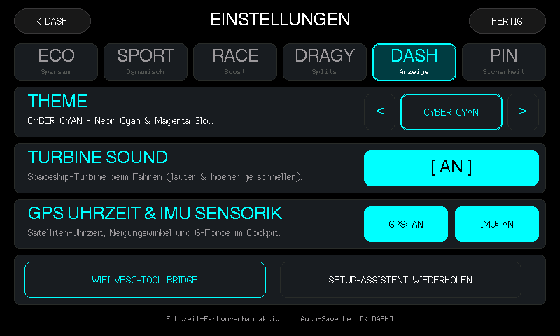 | 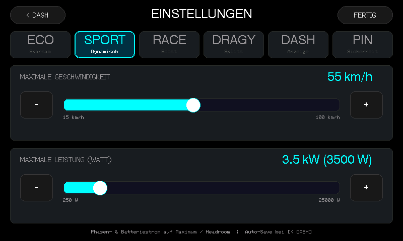 |
| **Wi-Fi Bridge (Kabelloses VESC Tool TCP Interface)** | **Dragy Split-Geschwindigkeiten Konfiguration** |
| 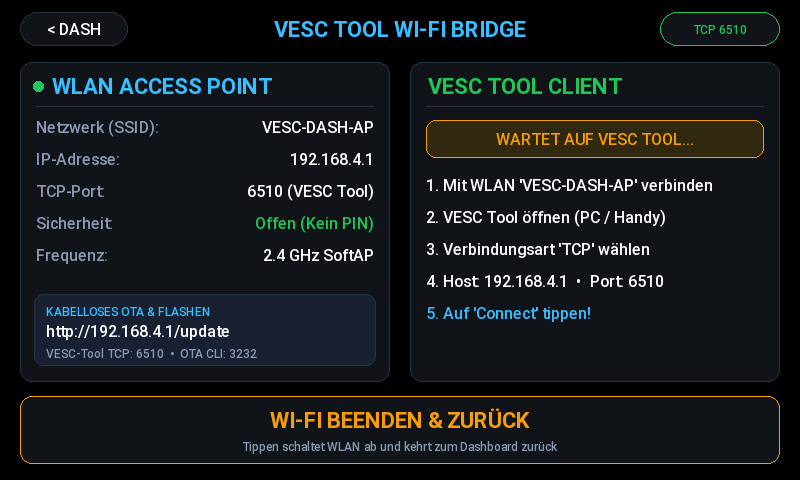 | 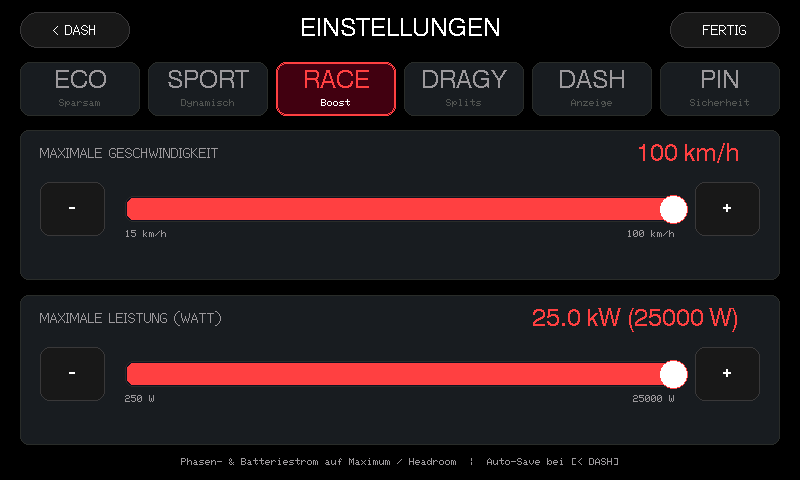 |

### 4. Beschleunigungsmessung (Dragy Launch Timer & Dyno)
| Live-Zeitmessung (z.B. 0–22, 0–50, 0–70 km/h) | Beschleunigungs-Dyno (Power & Drehmoment-Kurve) |
|:---:|:---:|
| 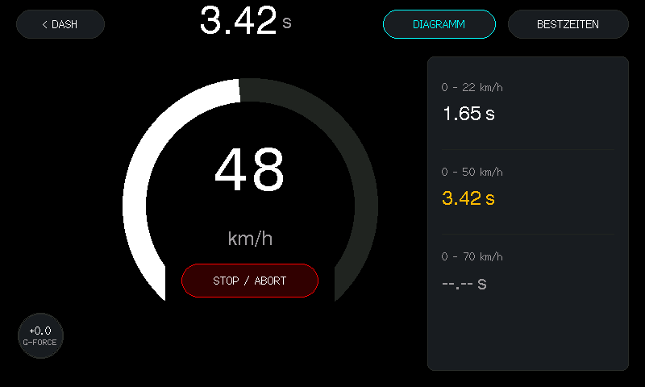 | 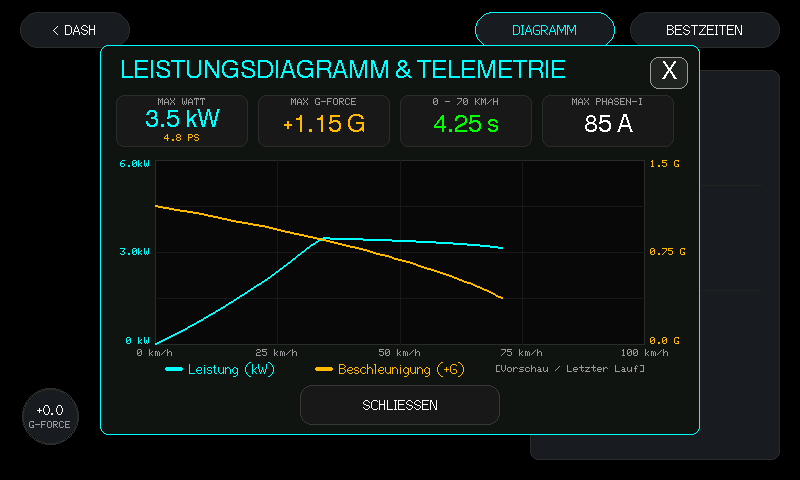 |
| **Persönliche Bestzeiten (NVS Speicher Modal)** | **Drossel-Modus (Diskreter roter Statuspunkt)** |
| 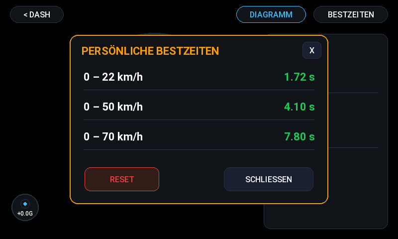 | 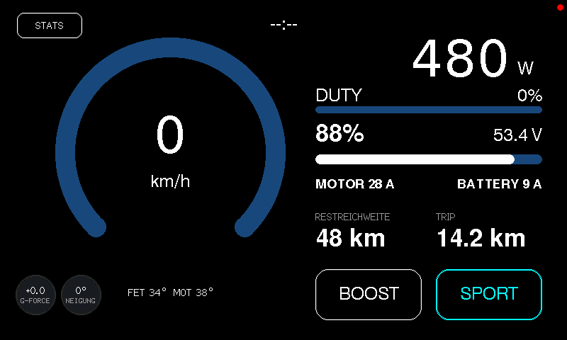 |

### 5. Sicherheit & System-Diagnose
| PIN-Wegfahrsperre beim Systemstart | VESC Fehlermeldungs-Alarmbanner |
|:---:|:---:|
| 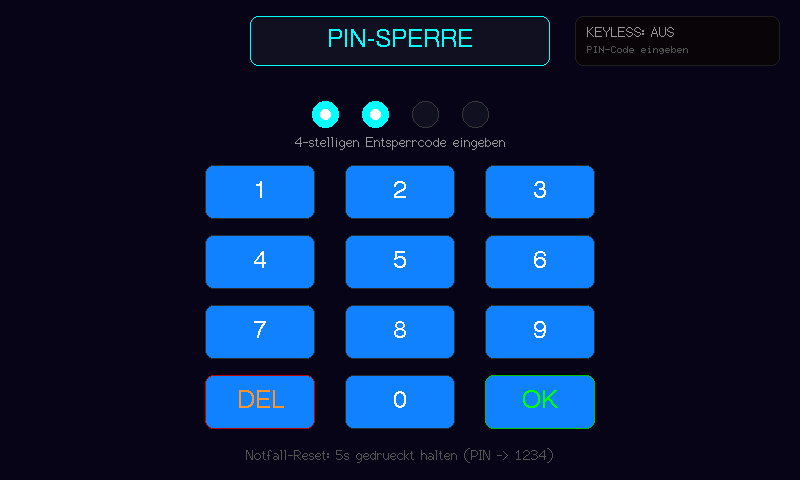 | 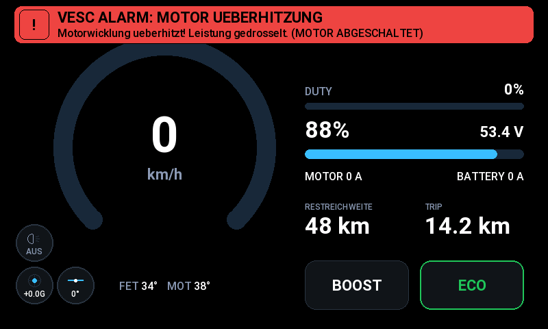 |
| **Erweiterte Fahrt-Statistiken & Helligkeit** | **PIN Fehleingabe-Animation** |
| 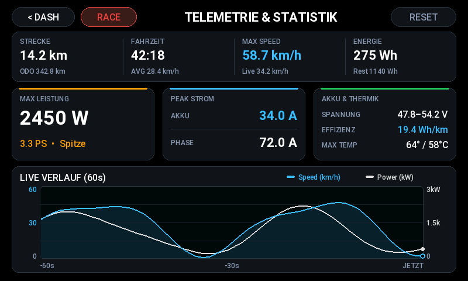 | 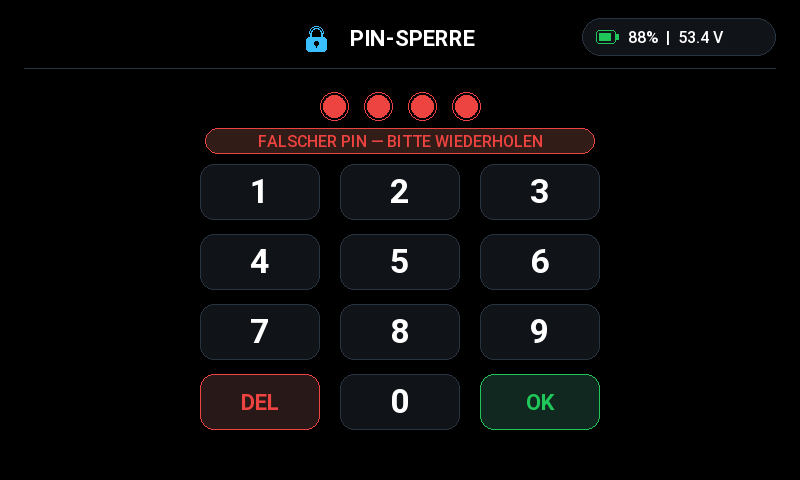 |

### 6. Diebstahlschutz & Drahtloses Keyless-Go
| Diebstahlschutz mit VESC FOC Motor-Sirene | Drahtloses Keyless-Go (Bluetooth Proximity) |
|:---:|:---:|
| 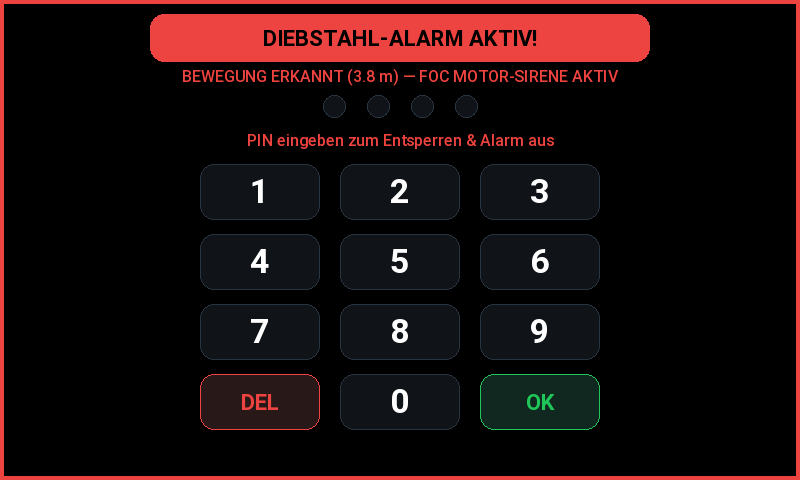 | 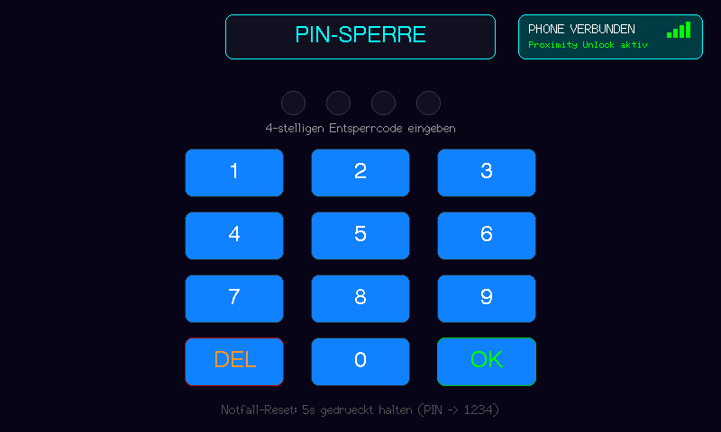 |

---

## 🌟 Spannende Features & Highlights

- 🔑 **Keyless-Go & Drahtloses Entsperren (BLE Proximity):**
  - **MAC-gesicherte Erkennung & Live-RSSI:** Verifiziert die gekoppelte Bluetooth-MAC-Adresse strikt gegen unbefugte Geräte und pollt die Live-RSSI-Signalstärke zyklisch (4-Balken-Anzeige).
  - **Fahrtbereit ohne PIN:** Bei Annäherung wird die PIN-Sperre sofort freigegeben; beim Entfernen (>10 s im Stillstand) wird der Antrieb selbsttätig wieder gesperrt.

- 🚨 **Diebstahlschutz mit VESC FOC Motor-Sirene:**
  - **Richtungsunabhängige Bewegungserkennung:** Wird das gesperrte Fahrzeug mehr als 2 Meter vorwärts **oder rückwärts** bewegt (`fabsf` auf Motor-ERPM/Speed), schlägt das System sofort Alarm.
  - **Motor als Sirene:** Nutzt Benjamin Vedders FOC-Audio-Modulation (`foc-beep`) direkt über die Motorwicklungen – extrem laut und durchdringend, ganz ohne externen Summer oder Lautsprecher!
  - **Auto-Lock Backlight-Sleep:** Nach 5 Minuten Inaktivität verriegelt sich das System automatisch und schaltet die Hintergrundbeleuchtung im Lockscreen energiesparend ab (Wecken per erstem Tipp ohne Fehleingabe).

- 👮 **One-Touch Polizei- & Drossel-Modus (Stealth Lock):**
  - **Sekundenschnelle Drosselung:** Ein einfacher Fingertipp auf die km/h-Anzeige riegelt das Fahrzeug sofort unumkehrbar auf 20 km/h (bzw. konfigurierte Werte) ab und sperrt Tuning-Tabs sowie `[ BOOST ]`.
  - **Diskreter Statuspunkt:** Ein winziger roter Subpixel-Punkt oben rechts im Eck signalisiert dem Fahrer unauffällig den Drosselstatus (im offenen Tuning-Modus unsichtbar).
  - **Geheimer Entsperr-Druck:** Das Umschalten in den offenen Tuning-Modus ist gegen versehentliches Auslösen gesichert und erfordert einen verdeckten 4-Sekunden-Druck auf die Geschwindigkeitszahl.

- ⏱️ **Dragy Launch Control & Beschleunigungs-Dyno:**
  - **Auto-Rollout & Plateau-Finish:** Startet automatisch bei Anfahrt (`>= 1.0 km/h`), erfasst konfigurierbare Split-Zeiten (z. B. 0–22, 0–50, 0–70 km/h) und beendet den Lauf bei Geschwindigkeits-Plateau (`< 0.2 m/s²` über 2 s) automatisch.
  - **Persönliche Bestzeiten:** Neue Rekorde werden automatisch mit Sternchen (`*PB*`) markiert, konsistent gegen die aktiven Split-Ziele verglichen und dauerhaft im NVS gespeichert.
  - **Live-Dyno Diagramm:** Integrierte Leistungs- und Drehmomentkurve visualisiert den Beschleunigungsverlauf direkt auf dem Touchscreen.

- 🛡️ **Traktionskontrolle (TCS), Auto-Reifenkalibrierung & Virtuelles TPMS:**
  - **Echtzeit-TCS (`< 5 ms` auf Core 0):** Erkennt Radschlupf über VESC vs. GPS bzw. physikalische Grip-Grenze und regelt den Phasenstrom ruckfrei ab.
  - **Virtuelles TPMS & GPS-Kalibrierung:** Kalibriert den exakten Abrollumfang bei Konstantfahrt und warnt bei schleichendem Reifendruckverlust.

- 🔋 **Dual-Akku-Management, Sag-freier SoC & Meter-genaues Odometer:**
  - **Dual-Profil & SOH-Schutz:** Verwaltet zwei Akku-Profile mit Coulomb/Wh-Integration, dynamischer 2-km-Restreichweite und lastfreiem SOH-Degradations-Learning (geschützt vor Beschleunigungs-Sag).
  - **Exakter Kilometerzähler:** Akkumuliert die Gesamtstrecke intern als `uint32_t` in Metern (kein Float-Rundungsfehler auch jenseits von 10.000 km).

- 📶 **Kabellose VESC Wi-Fi Bridge & Gzip-OTA Web-Flasher:**
  - Startet per Knopfdruck einen lokalen WLAN-Hotspot (`VESC-DASH-AP`, Port `6510` für VESC Tool, Port `80` für das gzip-komprimierte HTML5-OTA-Interface mit exakter 0–100%-Fortschrittsanzeige, sowie ArduinoOTA auf Port `3232`).

- 🧙 **Ersteinrichtungs-Assistent & PIN-Wegfahrsperre:**
  - Automatischer 3-Schritte-Setup-Wizard beim Erststart.
  - 4-stelliger PIN schützt vor unbefugter Nutzung (kann im Assistenten mit einem Klick auf `[ UEBERSPRINGEN > ]` auch abgewählt werden).
  - 5-Sekunden-Notfall-Reset-Geste für den Fall eines vergessenen Codes.

- 🎛️ **On-Screen Live-Settings (km/h & Watt):**
  - Geschwindigkeit und Maximalleistung können für jeden Fahrmodus (`ECO`, `SPORT`, `RACE`) bequem am Touchscreen per Schieberegler oder `[-]`/`[+]`-Tasten angepasst werden – ganz ohne VESC Tool oder Programmierkenntnisse.

- 🎨 **5 Wählbare Farb-Sets (Themes):**
  - **Cyber Cyan** (Standard), **Synthwave Outrun**, **Toxic Green**, **Racing Red** und **Clean Ice**.
  - Passen das gesamte Cockpit (Tacho-Bogen, Spuren, Akku-Leiste, Akzentfarben) dem individuellen Fahrzeugstil an.
  - Umschaltbar über Tab 4 (`DASH`) im Einstellungsmenü oder im Simulator (Taste `T`), dauerhaft im NVS gespeichert.

- 🚀 **FOC-Audio Triebwerkssound (Jet Engine Whine):**
  - Moduliert während der Fahrt einen dynamischen Turbinensound direkt über die Motorwicklungen mittels VESC FOC Audio (`foc-play-tone`).
  - **Lauter & höher desto schneller:** Tonhöhe (280 Hz bis 3200 Hz) und Lautstärke (1.2V bis 6.5V) skalieren fließend mit der Geschwindigkeit.
  - **Strikte Null-Interferenz:** Die akustische Schwingung erzeugt kein Nettodrehmoment – Fahrphysik, Gasannahme, Rekuperation und Schutzlimits bleiben zu 100% unberührt! Im Stillstand sofort lautlos.

- 💡 **2-Segment Stealth-WLED Engine (StVO-Rücklicht & Tuning-Unterbodenbeleuchtung):**
  - **Echtes 2-Segment Dual-Lighting (`GPIO 15` WS2812B/SK6812):** Segment 0 (12 LEDs) fungiert als dauerhaft StVO-konformes rotes Rücklicht mit aktivem Bremslicht-Strobe bei Rekuperation (`current_amps < -2A`) und pulsierendem Notbrems-Signal (`g_force < -0.5g`).
  - **Stealth-Unterbodenlicht:** Segment 1 (z. B. 48 LEDs) bleibt im Standard- & Polizei-Modus (`tuning_mode == false`) **strikt dunkel (0,0,0)**. Erst bei freigeschaltetem Tuning-Modus erwachen Custom-RGB-Farben, Rainbow, Color-Cycle, Scanner oder Speed-Glow (Farbe skaliert mit der Geschwindigkeit).
  - **Theme-Sync & Atem-Effekt:** Automatische Farbübernahme aus dem gewählten Dashboard-Theme sowie sanfter Puls-Effekt (`Locked-Breathe`) bei aktivierter Wegfahrsperre.

- 🌐 **Offizielle WLED-App JSON-API & Gzip Web-UI:**
  - **WLED-Ökosystem-Kompatibilität:** Vollständige Implementierung der offiziellen WLED-JSON-Schnittstelle (`/json`, `/json/info`, `/json/state`), sodass jede native WLED-Smartphone-App im WLAN das Fahrzeug als vollwertiges Beleuchtungs-Device erkennt und steuert.
  - **Integrierte Gzip Web-Oberfläche:** Leichtgewichtiges Web-UI unter `http://192.168.4.1/wled` (im AP-Modus) bzw. im Simulator unter `http://localhost:8080/wled` für interaktive Farb- und Effektwahl im Browser.

- 📟 **On-Screen Fault-Blackbox Modal (System-Diagnose):**
  - **Integrierte Fehler-Blackbox:** Im Einstellungsmenü unter Tab `[ SYSTEM ]` visualisiert die Schaltfläche `[ FAULT LOG (x) ]` alle aufgezeichneten VESC-Fehler (Spannung, Phasenstrom, MOSFET/Motor-Temperatur und System-Uptime).
  - **Touch-Modal & Löschfunktion:** Detailansicht mit komfortablem Scrollen, Klartext-Fehlerbezeichnungen und `[ LOG LOESCHEN ]`-Button mit NVS-Synchronisation.

- 🎮 **Segway G3 Max 5-Tasten ADC-Treiber & Kalibrier-CLI:**
  - **Ein-Draht ADC-Lenkertasten:** Liest bis zu 5 Lenkertasten über einen einzigen ADC-Pin (`ADC1_CH2` / `GPIO 3`) mit Hysterese und automatischer Spannungsfenster-Erkennung aus (Power, Mode, Blinker Links/Rechts, Hupe/Boost).
  - **`btn-cal` CLI:** Interaktive Kalibrierung über das USB-Terminal zum Einlernen individueller Widerstands-Werte mit direkter Speicherung im NVS.

- 💻 **Serielle USB-Diagnose, WLED-CLI & ESPmDNS:**
  - **Umfangreiche Serial-CLI:** USB-Diagnosekonsole (`help`, `status`, `reboot`, `factory-reset`, `btn-cal`) erweitert um dedizierte WLED-Befehle:
    * `wled status`: Zeigt Betriebsmodus, RGB, Helligkeit, aktiven Effekt und NVS-Status an.
    * `wled on` / `wled off`: Manuelles Ein- und Ausschalten.
    * `wled bri <0..255>`: Helligkeit einstellen.
    * `wled fx <0..4>`: Effekt umschalten (`0`=Solid, `1`=Speed-Glow, `2`=Atmen, `3`=Rainbow, `4`=Scanner).
    * `wled rear <1..60>`: LED-Anzahl des StVO-Rücklicht-Segments konfigurieren.
    * `wled save`: Sofortige NVS-Speicherung erzwingen.
  - **ESPmDNS Auto-Discovery:** Im WLAN-Bridge-Modus ist das Display unter `http://vesc-dash.local` sowie `http://vesc-dash.local/wled` im Netzwerk direkt erreichbar.
  - **Entprellte NVS-Persistenz & TAB_DASH Quick-Controls:** LED-Änderungen werden mit 1500 ms Hysterese materialschonend in den Flash geschrieben. Im Einstellungsmenü (`TAB_DASH`) stehen im Tuning-Modus On-Screen Touch-Buttons (`[ WLED ]`, `[ FX ]`, `[-]`/`[+]`) zur Verfügung; im Polizei-Modus bleiben diese zu 100% verborgen und gesperrt (Stealth).

---

## 👆 Touch-Gesten & Bedienung

Das gesamte System ist für schnelle, intuitive Bedienung mit Handschuhen während der Fahrt optimiert:

### 🟢 Im Fahrbetrieb (Haupt-Cockpit)
| Aktion | Touch-Geste / Bereich | Funktion |
|:---|:---|:---|
| **Fahrmodus wechseln** | Tipp auf `[ ECO / SPORT / RACE ]` (unten Mitte) | Schaltet zwischen den 3 Profilen um (HUD-Banner zeigt Wechsel) |
| **Boost aktivieren** | Tipp auf `[ BOOST ]` (unten rechts) | Aktiviert für 10 Sekunden maximalen Leistungs-Boost |
| **Statistiken / Graphen** | Wisch nach **Links** ($\leftarrow$) oder Tipp `[ STATS ]` | Öffnet Fahr-Statistiken, Wh/km und Live-Graphen |
| **Trip zurücksetzen** | Langer Druck (2s) unten links auf den Trip-Zähler | Setzt Tageskilometer (`TRIP km`) und Spitzenwerte auf 0 |
| **Einstellungen öffnen** | Tipp / langer Druck oben rechts (Touch-Zone `x >= 725, y <= 65`) | Öffnet das Einstellungsmenü für Limits und Display-Optionen |

### 🔒 Sicherheit & Drosselung (Polizei-Modus)
| Aktion | Touch-Geste / Bereich | Funktion |
|:---|:---|:---|
| **Sofort-Drossel (20 km/h)** | **1x Tipp auf die mittlere Geschwindigkeitszahl** | Verriegelt den Scooter blitzschnell auf 20 km/h (roter Statuspunkt erscheint) |
| **Tuning entsperren** | **4 Sekunden gedrückt halten auf die km/h-Zahl** | Schaltet offene Leistung und Höchstgeschwindigkeit wieder frei |
| **PIN-Wegfahrsperre** | PIN auf dem On-Screen Keypad eingeben | Entsperrt das Fahrzeug beim Booten oder schaltet Diebstahl-Alarm aus |
| **Notfall PIN-Reset** | 5 Sekunden Dauerdruck auf den PIN-Sperrbildschirm | Notfall-Rücksetzung des PINs auf Werkseinstellung (`1234`) |

### 🧭 Navigation & Untermenüs
| Aktion | Touch-Geste / Bereich | Funktion |
|:---|:---|:---|
| **Zurück zum Dashboard** | Tipp auf `[ < DASH ]` (oben links) | Kehrt aus jedem Menü oder dem Race-Timer sofort zum Cockpit zurück |
| **Helligkeit anpassen** | Hardware-Schaltung via CH422G (>20% an / <=20% aus) bzw. Software-Dimming | Display-Hintergrundbeleuchtung schaltet hardwareseitig binär an/aus |
| **Dragy Race starten** | Tipp auf `[ RACE ]` (Stats-Screen, nur bei Tuning) | Öffnet den Beschleunigungs-Timer mit 5s Launch Control |
| **Parameter anpassen** | Slider / `[-]` / `[+]` in den Einstellungen | Geschwindigkeits- (km/h) und Leistungslimits (Watt) direkt verstellen |

---

## 🔌 Hardware-Verkabelung

### 1. Display Pinbelegung (Waveshare ESP32-S3-Touch-LCD-4.3 & 7.0)
- **Display-Treiber:** ST7262 RGB Parallel Interface (800 × 480 @ **12 MHz PCLK**, `pclk_active_neg = 1`, PSRAM Backbuffer + Dirty-Rect-Blitting)
- **Sync-Leitungen:** HSYNC = GPIO 46, VSYNC = GPIO 3, DE = GPIO 5, PCLK = GPIO 7
- **16-Bit RGB565:**
  - Blau (B0–B4): GPIO 14, 38, 18, 17, 10
  - Grün (G0–G5): GPIO 39, 0, 45, 48, 47, 21
  - Rot (R0–R4): GPIO 1, 2, 42, 41, 40
- **Touch:** Goodix GT911 (I2C SDA = GPIO 8, SCL = GPIO 9, INT = GPIO 4)
- **IO-Expander:** CH422G (I2C `0x24`), EXIO2 steuert die Display-Hintergrundbeleuchtung

### 2. VESC-Verbindung (CAN-Bus oder UART)
Die Verbindung erfolgt wahlweise über **CAN-Bus** (empfohlen) oder **UART**. Umschaltbar in [`include/board_config.h`](include/board_config.h):
```c
#define VESC_USE_CAN_BUS 1   // 1 = High-Speed CAN Bus (500 kbps), 0 = UART (115200)
```

#### CAN-Bus Verkabelung (Empfohlen)
Nutzt den integrierten TJA1051 CAN-Transceiver des Displays:
| Display Klemme | VESC CAN Port | Funktion |
|:---|:---|:---|
| **5V / VCC** | `5V` | Stromversorgung vom internen 5V BEC des VESC |
| **GND** | `GND` | Gemeinsame Masse |
| **CAN_H** | `CAN_H` | CAN High (500 kbps) |
| **CAN_L** | `CAN_L` | CAN Low (500 kbps) |

> [!TIP]
> Bei Nutzung von CAN-Bus bleibt der `COMM / UART`-Port des VESC frei für Bluetooth-Module oder Zubehör.

#### UART Verkabelung (Alternative)
| Display Pin | VESC COMM Port | Funktion |
|:---|:---|:---|
| **5V / VCC** | `5V` | Stromversorgung |
| **GND** | `GND` | Gemeinsame Masse |
| **TX (GPIO 43)** | `RX` | Senden (115200 Baud) |
| **RX (GPIO 44)** | `TX` | Empfangen (115200 Baud) |

### 3. GPS / BDS GNSS Modul & 12V-Scheinwerfer (im CAN-Modus)
- **GPS TX** $\rightarrow$ **ESP32 RX** (GPIO 44, NMEA 9600 Baud mit `*hh` XOR-Checksummenprüfung)
- **12V Scheinwerfer MOSFET (`TRIG`)** $\leftarrow$ **ESP32 TX** (GPIO 43, 3.3V Logik für D4184)
- **VCC (5V)** und **GND**

---

## 🏗️ Software-Architektur

- **Dual-Core FreeRTOS-Entkopplung:**
  - **Core 0 (200 Hz Echtzeittask):** `Vesc.update()` (Dual-VESC CAN/UART mit Multi-Node-Isolation), `TcsTpmsManager`, `GpsTracker` (128-B-Burst-Limit), Non-Blocking Wi-Fi/USB-Bridge und asynchroner Limit-Push; pausiert sauber während OTA-Flash-Writes.
  - **Core 1 (UI & Input):** 800×480 PSRAM-Backbuffer, selektives Dirty-Rect-Blitting, 60-Hz GT911-Touch und Screen-Rendering über eine Double-Buffered Telemetrie-Mailbox.
- **Modulare Struktur:**
  - `src/dash_renderer.cpp`, `src/screen_race.cpp`, `src/screen_settings.cpp`, `src/screen_wizard_pin.cpp` + `include/ui_layout.h` (Single Source of Truth für alle Touch-Hitboxen)
  - `src/serial_cli.cpp` (USB-Diagnosekonsole), `include/dash_log.h` (schaltbares Release-Logging)
  - Flash-schonende NVS-Blob-Speicherung mit Dirty-Checks (`ModeManager`, `FaultManager`, `BatteryManager`, `SettingsManager`)

---

## 💻 Simulator, Regressionstests & OTA

Das Repository enthält einen nativen Desktop-Simulator mit integriertem VESC-Protokoll-Emulator und **16 automatischen Regressionstests**:

```bash
# Umfassende Qualitäts- & Syntaxprüfung aller Module ausführen:
./tools/check_all.sh

# Live-Demo mit grafischem Fenster & Web-Stream starten
DISPLAY=:0 python3 tools/simulator/live_demo.py

# Simulator neu bauen + alle UI-Szenarien & 16 Regressionstests ausführen
./tools/simulator/build_and_run.sh

# Drahtloses OTA-Update über WLAN (Standard: 4.3" Display):
python3 tools/ota_flash.py --board 43

# Drahtloses OTA-Update für Waveshare 7.0" Display:
python3 tools/ota_flash.py --board 70
```
- **Web-Interface:** [http://localhost:8080](http://localhost:8080) (interaktiver Stream mit Touch-Unterstützung).
- **WLED Web-Preview:** [http://localhost:8080/wled](http://localhost:8080/wled) (interaktive LED-Steuerung im Browser).
- **VESC Tool TCP Server:** TCP-Port `6510` zum direkten Testen mit dem offiziellen VESC Tool.

---

## ⚡ Flashen auf das Board (Schritt-für-Schritt)

### 1. Voraussetzungen
- **Hardware:** Waveshare ESP32-S3-Touch-LCD-4.3 (oder kompatibles RGB-Board aus der Liste).
- **Kabel:** Hochwertiges USB-C Datenkabel (am USB-Port des ESP32-S3 Boards angeschlossen, nicht am reinen UART-Port).
- **Software:** 
  - [PlatformIO Core (CLI)](https://platformio.org/install/cli) oder **VS Code** mit installierter **PlatformIO IDE** Extension.
  - Python 3.9+ installiert.

### 2. Konfiguration vor dem Flashen
Öffne [`include/board_config.h`](include/board_config.h) und prüfe folgende Grundeinstellungen:
```c
// 1 = Echte Hardware (ESP32-S3), 0 = Desktop-Simulator
#define SIMULATION_MODE 0

// 1 = CAN-Bus (500 kbps, empfohlen), 0 = UART (115200 Baud)
#define VESC_USE_CAN_BUS 1

// Fahrzeug-Parameter für exakte Geschwindigkeits- und Distanzberechnung:
#define WHEEL_DIAMETER_INCH   10.0f   // Reifendurchmesser in Zoll (z. B. 10.0" oder 11.0")
#define MOTOR_POLE_PAIRS      15      // Polpaare des Motors (Standard: 15 für Hub-Motoren)
#define GEAR_RATIO            1.0f    // 1.0 bei Direktantrieb / Hub-Motor
```

### 3. Linux-Nutzer: USB-Zugriffsrechte setzen
Unter Linux benötigt PlatformIO Schreibrechte auf die serielle USB-Schnittstelle (`/dev/ttyACM*`):
```bash
# Benutzer zur dialout-Gruppe hinzufügen:
sudo usermod -a -G dialout $USER

# Alternativ temporär Schreibrechte auf den Port vergeben:
sudo chmod 666 /dev/ttyACM*
```
*(Nach dem Gruppen-Befehl einmal ab- und wieder anmelden)*

### 4. Kompilieren & Flashen
Verbinde das Board per USB-C mit dem PC und starte den Build & Flash-Prozess für deine Display-Größe:

```bash
# Waveshare ESP32-S3-Touch-LCD-4.3 (4.3" Referenz-Display):
pio run -e waveshare-esp32-s3-touch-lcd-43 -t upload

# Waveshare ESP32-S3-Touch-LCD-7 (7.0" Display):
pio run -e waveshare-esp32-s3-touch-lcd-7 -t upload
```

> [!TIP]
> **Board wird nicht erkannt oder hängt bei `Connecting... ___...___`?**  
> Bring das Board manuell in den ESP32-S3 Bootloader-Modus:
> 1. Die **BOOT-Taste** auf dem Board gedrückt halten.
> 2. Die **RESET-Taste** kurz drücken.
> 3. Die **BOOT-Taste** loslassen.
> 4. `pio run -e <env> -t upload` erneut ausführen.

### 5. Serieller Monitor & Erster Start
Starte nach dem Flashen den seriellen Monitor, um Telemetrie- und VESC-Logs einzusehen:
```bash
pio device monitor -b 115200
```
- Beim allerersten Start startet das Display automatisch den **Ersteinrichtungs-Assistenten** (Setup Wizard).
- Folge den 3 Schritten auf dem Touchscreen (Schnellanleitung $\rightarrow$ PIN-Wahl $\rightarrow$ Hardware-Optionen) – schon ist das Cockpit fahrbereit!

---

## 📄 Lizenz
MIT License. Frei nutzbar für private und kommerzielle Projekte.
