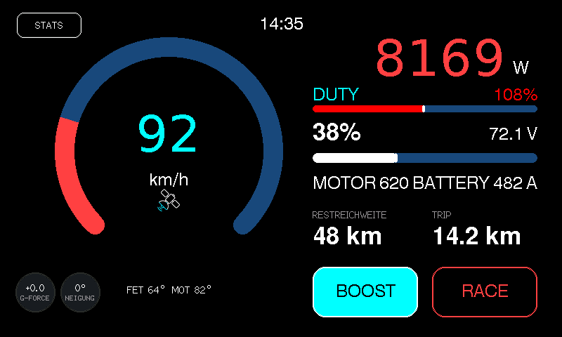
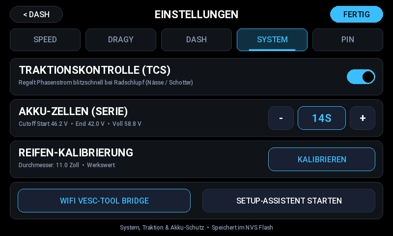
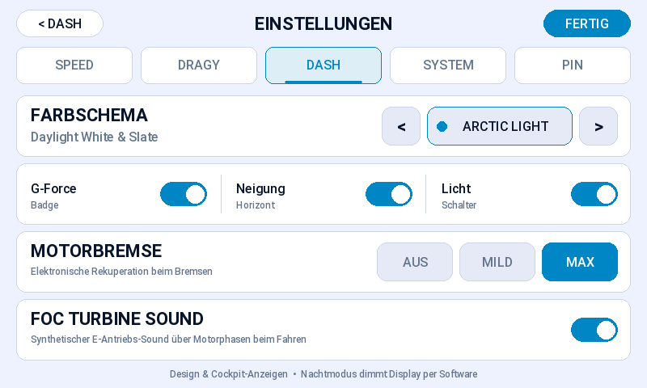
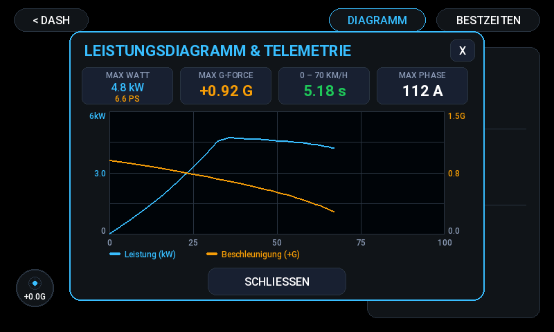
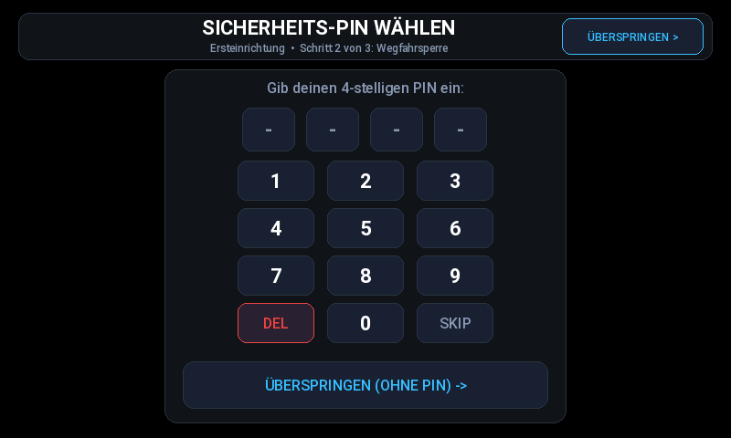
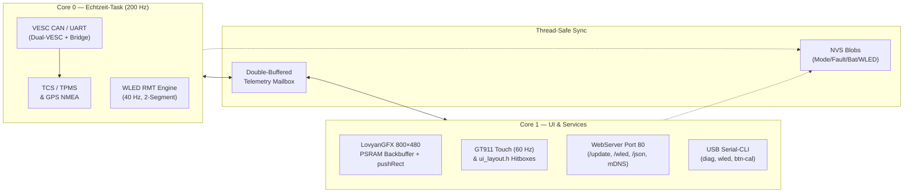

<div align="center">

# ⚡ VESC HyperDash — ESP32-S3 Touch Display (800×480)

**Autarkes, flackerfreies Digital-Cockpit für VESC-basierte E-Scooter, E-Bikes & LEVs**<br>
*Dual-Core FreeRTOS · 800×480 PSRAM Backbuffer · 2-Segment Stealth-WLED · Dragy Launch/Dyno · BLE Keyless-Go*


<br>



</div>

---

## 📑 Inhaltsverzeichnis

- [Highlights](#-highlights)
- [Screenshots](#-screenshots)
- [2-Segment Stealth-WLED & WLED-App](#-2-segment-stealth-wled--wled-app)
- [Touch-Bedienung & Gesten](#-touch-bedienung--gesten)
- [Kompatible Hardware & Verkabelung](#-kompatible-hardware--verkabelung)
- [Dual-Core Architektur](#-dual-core-architektur)
- [Flashen (4.3" & 7.0") & OTA](#-flashen-43--70--ota)
- [USB Serial-CLI (`diag`, `wled`, `btn-cal`)](#-usb-serial-cli-diag-wled-btn-cal)
- [Desktop-Simulator & Tests](#-desktop-simulator--tests)

---

## 🌟 Highlights

### 🏎️ Cockpit, Fahrphysik & Telemetrie
- **100 % Flackerfreie Grafik:** 800×480 16-Bit RGB565 Parallel-Interface mit **PSRAM Off-Screen-Backbuffer**, selektivem **Dirty-Rect-Blitting (`pushRect`)** und harmonisierten 12-MHz-ST7262-Timings (exakter 240/20 Integer-Teiler) für **Waveshare 4.3" & 7.0"**.
- **5 Themes:** *Hyper Cyan*, *Obsidian Dark*, *Arctic Light*, *Carbon Stealth* und *Night Dim* — direkt am Display umschaltbar.
- **Dragy Launch Control & Live-Dyno:** Auto-Rollout (`>= 1.0 km/h`), konfigurierbare Split-Zeiten (z. B. 0–22 / 0–50 / 0–70 km/h), automatisches Plateau-Finish (`< 0.2 m/s²` über 2 s), NVS-Bestzeiten (`*PB*`) und Leistungs-/Drehmoment-Kurve.
- **Echtzeit-TCS & Virtuelles TPMS:** Core-0 Traktionskontrolle (`< 5 ms` Eingriff bei Radschlupf via VESC vs. GPS/IMU) + GPS-Reifenkalibrierung & Druckverlust-Warnung.
- **Dual-Akku-Management & Meter-genaues Odometer:** Coulomb/Wh-Integration, lastfreies SOH-Learning (Sag-geschützt) und interner `uint32_t`-Meterzähler ohne Float-Drift.
- **FOC-Audio Turbinensound:** Dynamischer Jet-Whine direkt über die Motorwicklungen (`foc-play-tone`), drehmomentneutral und im Stand sofort lautlos.

### 🔒 Sicherheit, Stealth & Diebstahlschutz
- **One-Touch Polizei- / Drossel-Modus:** Ein Tipp auf die `km/h`-Zahl drosselt sofort auf legale Limits (`ECO 15 / SPORT 20 / RACE 22 km/h`), sperrt `[ BOOST ]`, versteckt alle Tuning-Tabs sowie die WLED-Controls und schaltet die Unterbodenbeleuchtung auf `(0, 0, 0)` aus. Entsperren nur per verdecktem **4-Sekunden-Druck** auf die `km/h`-Zahl.
- **PIN-Wegfahrsperre & BLE Keyless-Go:** 4-stelliger PIN (optional im 3-Schritte-Setup-Wizard), 5s-Notfall-Reset, MAC-verifiziertes Bluetooth-Proximity-Unlock mit Live-RSSI (4 Balken) und Auto-Lock Backlight-Sleep.
- **VESC FOC Motor-Sirene:** Erkennt Vorwärts- **und Rückwärtsbewegung** (`fabsf`) im gesperrten Zustand (> 2 m) und schlägt über die Motorwicklungen (`foc-beep`) + WLED Rot/Blau-Strobe sofort Alarm.

### 🛠️ Diagnose & Steuerung
- **On-Screen Fault-Blackbox Modal:** Im Tab `[ SYSTEM ]` zeigt `[ FAULT LOG (N) ]` die letzten 7 VESC-Fehler mit deutscher Klartext-Diagnose, Spannung, Strom, FET/Motor-Temp & Uptime inkl. `[ LOG LOESCHEN ]`.
- **Segway G3 Max 5-Tasten ADC-Lenkerblock:** Optionaler Ein-Draht-Widerstandsleiter-Treiber (`ENABLE_STEERING_BUTTONS`) mit 30-ms-Debounce, Short/Long-Press und `btn-cal` Kalibrierungsbefehl.
- **VESC Wi-Fi Bridge & geschütztes OTA:** AP-Hotspot (`VESC-DASH-AP`, TCP Port `6510` fürs VESC Tool, Port `80` Gzip-OTA-Flasher + WLED, Port `3232` ArduinoOTA) mit **`0xE9` Magic-Byte-Validierung** & `ESP.getFreeSketchSpace()`-Guard gegen defekte `.bin`-Dateien.

---

## 📸 Screenshots

| Fahr-Cockpit (Sport / Race + Boost) | Minimal-Modus (ohne GPS/IMU) |
|:---:|:---:|
|  |  |
| **Settings — `TAB_SYSTEM` (inkl. Fault-Log)** | **Settings — Arctic Light Theme** |
|  |  |
| **Dragy Launch Timer** | **Beschleunigungs-Dyno** |
|  |  |
| **PIN-Sperre & Diebstahl-Alarm** | **Setup Wizard (Erststart)** |
|  |  |

---

## 💡 2-Segment Stealth-WLED & WLED-App

Die Zero-Heap Hardware-RMT Engine auf **`GPIO 15`** (WS2812B / SK6812 / WS2815, `60 LEDs` @ `40 Hz` non-blocking) teilt den LED-Streifen in **2 unabhängige Segmente**:

| Segment | LED-Bereich | Polizei-Modus (`!tuning_mode`) | Tuning-Modus (`tuning_mode`) |
|:---|:---:|:---|:---|
| **Seg 0 — Rücklicht / Bremse** | `0 .. rear-1` (Default `12`) | ✅ **Aktiv:** Dezentes Rot, helles Brems-Rot (`I < -2 A` / `G < -0.45`), Notbrems-Pulsieren (`G < -0.65`, 60 ms) | ✅ **Aktiv:** Identisches Rück- & adaptives Bremslicht |
| **Seg 1 — Unterboden (Underglow)** | `rear .. 59` | 🚫 **Strikt `(0, 0, 0)` AUS (100 % Stealth)** | ✨ **Aktiv:** 5 Effekte (`Solid`, `Speed-Glow`, `Breathe`, `Rainbow`, `Scanner`), Custom-RGB oder Theme-Sync |
| **Diebstahl-Alarm Override** | `0 .. 59` (beide) | 🚨 Rot/Blau-Strobe @ 100 ms | 🚨 Rot/Blau-Strobe @ 100 ms |

### Steuerung (3 Wege — alle synchron & im NVS gespeichert)
1. **Direkt am Touchscreen (`TAB_DASH`, nur im Tuning-Modus sichtbar):** `[ WLED: AN/AUS ]`, `[ FX ]` und Helligkeit `[-]` / `[+]` in exakten **10%-Schritten** (`0%..100%`).
2. **Offizielle WLED Smartphone-App:** Automatisch auffindbar im AP-WLAN über **ESPmDNS (`vesc-dash.local`, `_wled._tcp`)** oder manuell über `192.168.4.1` (`/json`, `/json/info`, `/json/state`, `/json/si`, `/json/eff`, `/json/pal`, `/json/nodes`).
3. **Integrierte WLED Studio Web-UI:** `http://192.168.4.1/wled` bzw. `http://vesc-dash.local/wled` (Gzip-komprimiert, 3,9 KB Flash, Live-Stealth-Status & 60-LED-Vorschau).

*(Änderungen werden entprellt nach 1500 ms in NVS `vesc_wled` gespeichert — während eines OTA-Updates werden NVS-Writes automatisch pausiert.)*

---

## 👆 Touch-Bedienung & Gesten

| Bereich / Screen | Geste | Aktion |
|:---|:---|:---|
| **Haupt-Cockpit** | Tipp auf `[ ECO / SPORT / RACE ]` | Fahrmodus wechseln |
| **Haupt-Cockpit** | Tipp auf `[ BOOST ]` | 10s Leistungs-Boost (im Polizei-Modus gesperrt) |
| **Haupt-Cockpit** | Wisch nach **Links** oder Tipp `[ STATS ]` | Statistiken & Live-Graphen (dort `[ RACE ]` für Dragy) |
| **Haupt-Cockpit** | Langer Druck (2 s) unten links | Trip-Zähler zurücksetzen |
| **Haupt-Cockpit** | Tipp oben rechts (`x >= 725, y <= 65`) | Einstellungsmenü öffnen |
| **Polizei-Modus** | **1× Tipp auf die `km/h`-Zahl** | Sofort-Drossel aktivieren (roter Statuspunkt oben rechts) |
| **Tuning-Modus** | **4 s gedrückt halten auf `km/h`-Zahl** | Offenen Tuning-Modus entsperren |
| **PIN-Sperrbildschirm** | **5 s Dauerdruck** | Notfall-PIN-Reset auf `1234` |

---

## 🔌 Kompatible Hardware & Verkabelung

### Unterstützte Boards
| Board | Auflösung | Touch | PlatformIO Environment | Status |
|:---|:---:|:---:|:---|:---:|
| **Waveshare ESP32-S3-Touch-LCD-4.3 / 4.3B** | 800×480 RGB | GT911 (I2C `0x5D`) | `waveshare-esp32-s3-touch-lcd-43` | ✅ Referenz |
| **Waveshare ESP32-S3-Touch-LCD-7.0** | 800×480 RGB | GT911 (I2C `0x5D`) | `waveshare-esp32-s3-touch-lcd-7` | ✅ Voll kompatibel |
| **Sunton / Guition / Elecrow 4.3"–7" RGB** | 800×480 RGB | GT911 | Pin-Mapping in `board_config.h` | ✅ Kompatibel |

> [!IMPORTANT]
> **Stromversorgung (besonders fürs 7.0"-Display!):**
> Beide Waveshare-Boards laufen mit **5 V**. Ein interner VESC/Ubox-`5V`-BEC reicht für den Einschaltstrom des 7.0"-Backlights oft nicht aus — nutze stattdessen einen dedizierten **12V→5V DC-DC Buck-Converter (3–5 A)**!

### Pinbelegung & Peripherie (`include/board_config.h`)
| Funktion | Display-Pin / Klemme | Ziel / Hinweis |
|:---|:---|:---|
| **VESC CAN-Bus *(empfohlen)*** | `CAN_H` / `CAN_L` (TJA1051, 500 kbps) | VESC CAN-Port (`VESC_USE_CAN_BUS 1`) |
| **VESC UART *(Alternative)*** | `TX` (`GPIO 43`) / `RX` (`GPIO 44`) | VESC COMM-Port (`115200 Baud`, `VESC_USE_CAN_BUS 0`) |
| **GPS / GNSS Modul** | `RX` (`GPIO 44`, 9600 Baud NMEA) | Im CAN-Modus frei; mit `*hh`-Checksummenprüfung |
| **12V-Scheinwerfer MOSFET** | `GPIO 43` (`3.3V` Logik → `TRIG`) | Schaltet 12V-Licht per D4184-MOSFET |
| **WLED Streifen (WS2812B)** | `GPIO 15` (Hardware-RMT) | `60 LEDs` (Seg 0 Rücklicht + Seg 1 Unterboden) |
| **Segway G3 Max 5-Tasten** | `GPIO 3` (`ADC1_CH2`) | Optional (`ENABLE_STEERING_BUTTONS 1`), Kalibrierung via `btn-cal` |
| **Backlight / IO-Expander** | I2C `SDA=8`, `SCL=9`, `INT=4` | CH422G (`0x24`, `EXIO2` Backlight) + GT911 (`0x5D`) |

---

## 🏗️ Dual-Core Architektur



---

## ⚡ Flashen (4.3" & 7.0") & OTA

### Voraussetzungen
- [PlatformIO Core (CLI)](https://platformio.org/install/cli) oder VS Code + PlatformIO IDE
- Unter Linux ggf. USB-Rechte: `sudo usermod -a -G dialout $USER` (danach neu anmelden)

### 1. Per USB-C flashen
```bash
# Waveshare 4.3" Display:
pio run -e waveshare-esp32-s3-touch-lcd-43 -t upload

# Waveshare 7.0" Display:
pio run -e waveshare-esp32-s3-touch-lcd-7 -t upload

# Serieller Monitor (115200 Baud):
pio device monitor -b 115200
```

> [!TIP]
> **Bootloader-Modus bei Verbindungsproblemen:** **BOOT** halten → **RESET** kurz drücken → **BOOT** loslassen → Upload erneut starten.

### 2. Kabellos per WLAN-OTA flashen
Am Display im Tab `[ SYSTEM ]` die **Wi-Fi Bridge** aktivieren, mit `VESC-DASH-AP` verbinden und:
```bash
# 4.3" Firmware kabellos flashen:
python3 tools/ota_flash.py --board 43

# 7.0" Firmware kabellos flashen:
python3 tools/ota_flash.py --board 70
```
Oder direkt im Browser unter `http://192.168.4.1/update` (bzw. `http://vesc-dash.local/update`).

---

## 💻 USB Serial-CLI (`diag`, `wled`, `btn-cal`)

Über `pio device monitor -b 115200` stehen Zero-Heap Diagnose- und Testbefehle bereit:

| Befehl | Funktion |
|:---|:---|
| `diag` | Kompletter Hardware-Check: Board (4.3"/7.0"), LCD-Takt, Uptime, FreeHeap/MinHeap/PSRAM, **Core-0 Stack High-Water-Mark**, VESC, Akku, Odometer, Faults, WLED |
| `wled status` / `on` / `off` | WLED-Status anzeigen oder Streifen ein-/ausschalten |
| `wled bri <0..255>` | Helligkeit setzen |
| `wled fx <0..4>` | Effekt wählen (`0`=Solid, `1`=Speed-Glow, `2`=Breathe, `3`=Rainbow, `4`=Scanner) |
| `wled rear <0..30>` | Anzahl der Rücklicht-LEDs (Segment 0) anpassen |
| `wled color <r> <g> <b>` | Custom-RGB-Farbe setzen (schaltet Theme-Sync aus) |
| `wled theme` | Theme-Sync wieder aktivieren |
| `wled save` | WLED-Konfiguration sofort in NVS schreiben |
| `btn-cal` | Interaktive ADC-Kalibrierung für den 5-Tasten-Lenkerblock |
| `help` / `status` / `reboot` / `factory-reset` | Hilfe, Kurzstatus, Neustart, Werksreset |

---

## 🖥️ Desktop-Simulator & Tests

Der native C++-Simulator bildet die komplette Display-Engine inklusive virtuellem VESC-Emulator und **18 automatischen Regressionstests** ab:

```bash
# Komplett-Prüfung (Python-Syntax, Dual-Target-Config, Simulator-Build, 18/18 Tests, Git-Diff):
./tools/check_all.sh

# Nativen Desktop-Simulator starten (flüssiges 800×480 Fenster, ohne Browser-Overhead):
python3 tools/simulator/live_demo.py

# Optional mit Web-Stream & WLED-Studio Preview (http://localhost:8080 & /wled):
python3 tools/simulator/live_demo.py --web
```

---

## 📄 Lizenz

MIT License — frei nutzbar für private und kommerzielle Projekte.
