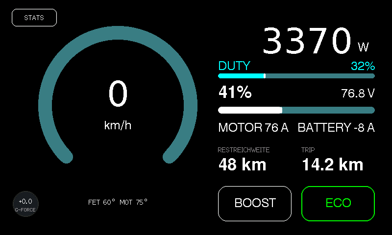
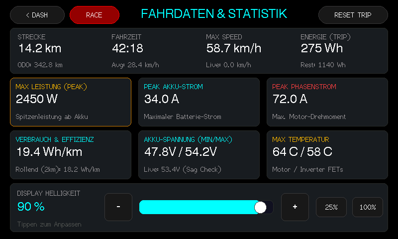
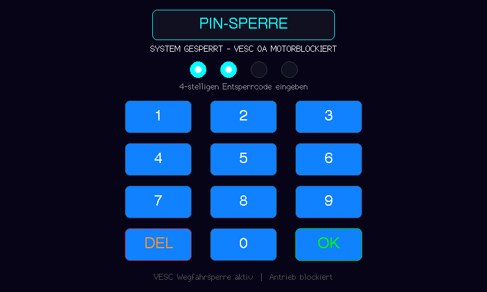
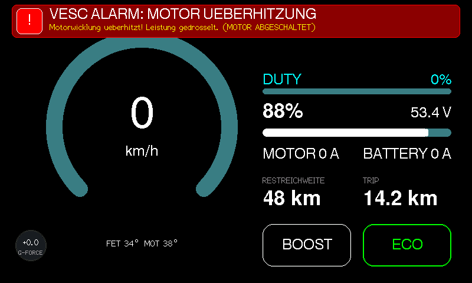
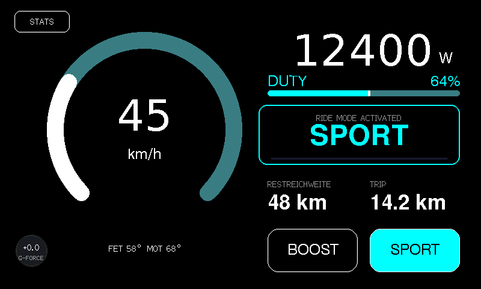
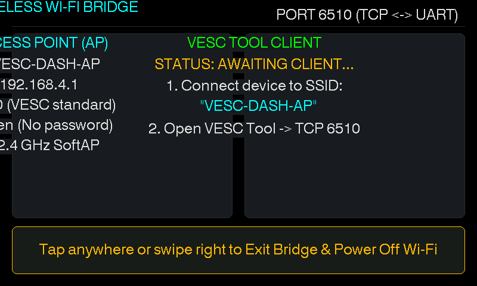
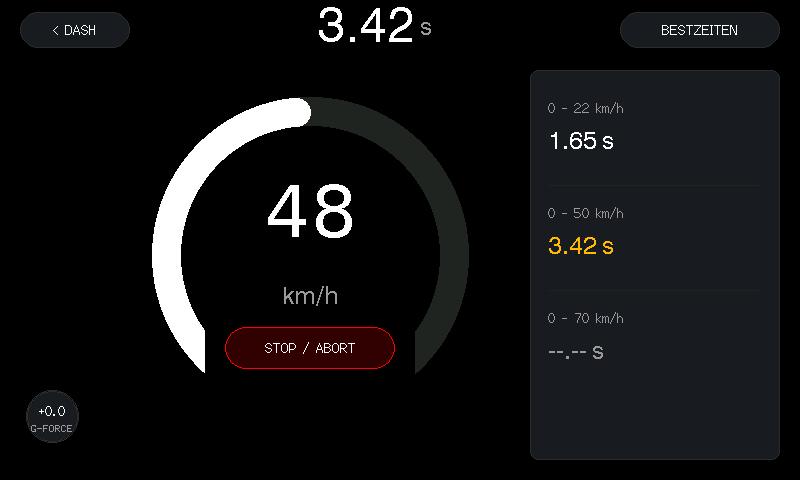
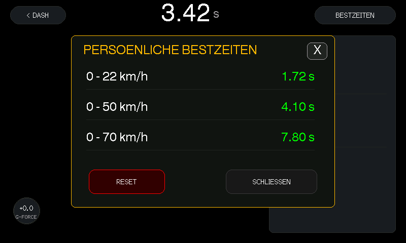

# VESC 4.3" Touch Display (800x480) - Waveshare ESP32-S3
## Flagship Hyper-VESC 35kW+ Cluster & Touch Dashboard

Custom high-performance dashboard for VESC-driven electric scooters, e-bikes, and hyper-scooters, optimized for the **Waveshare ESP32-S3-Touch-LCD-4.3** (800×480 RGB LCD, Goodix GT911 capacitive touch, 16MB Flash, 8MB Octal PSRAM).

<p align="center">
  
</p>

---

## 📸 Screenshots

| Hyper 35kW+ Cluster | Extended Stats & Brightness Slider |
|:---:|:---:|
|  |  |
| **PIN Security Lockscreen** | **VESC Fault Alarm Banner** |
|  |  |
| **Mode Banner HUD Overlay** | **Wi-Fi Bridge & Diagnostics** |
|  |  |
| **RACE Dragy / Launch Timer** | **Personal Best Records Modal** |
|  |  |

---

## 🚀 Key Features

### 1. Flagship Hyper-35kW+ Cluster (Screen 0)
- **High-Contrast Digital Speedometer:**
  - Giant speed readout with a 270° arc gauge.
  - **Startup Needle Sweep:** Automotive gauge sweep animation on boot/unlock (smoothly sweeps from 0 → 100 km/h → 0 km/h).
  - Dynamic color transitions based on speed and acceleration.
  - Centered thermal telemetry underneath: `FET 60°  MOT 75°`.
- **Mode Banner Transition HUD:**
  - Clean animated horizontal HUD overlay when changing ride modes (`[ ECO ]`, `[ SPORT ]`, `[ RACE ]`), keeping the speedometer visible at all times.
- **Power & Regenerative Braking Card:**
  - Real-time power measurement (up to 35 kW peak).
  - True bi-directional regen readout: switches into negative emerald-green (e.g. `-820 W` / `-310 W`) during braking.
- **Battery & Phase Currents:**
  - High-precision SoC percentage and voltage readout supporting 10S to 24S packs (up to 105 V).
  - Live Motor Phase Current (`MOTOR 142 A`) and Battery Current (`BATTERY 83 A`).
  - Minimalist dynamic remaining range readout (`RESTREICHWEITE 48 km`).
  - **Live Trip Distance Readout:** Cockpit trip odometer (`TRIP 14.2 km`) positioned in the cockpit cluster above the mode button.
- **Interactive Touch Buttons:**
  - `[ BOOST ]`: Triggers a 10-second 120% power burst.
  - `[ ECO / SPORT / RACE ]`: Cycles through active power profiles.

### 2. Extended Stats & Telemetry Grid (Screen 2)
- **Ride Summary:** Trip Distance, Total Odometer, Elapsed Ride Time (HH:MM:SS), Average Speed, Max Speed, and Watt-hours consumed/remaining.
- **Diagnostics Grid:**
  - **Max Power (Peak):** Highest recorded power output with golden accent frame.
  - **Peak Battery Current:** Peak DC amps drawn from the pack.
  - **Peak Phase Current:** Maximum motor torque demand.
  - **Consumption & Efficiency:** Trip energy efficiency (`Wh/km`) and dynamic rolling 2 km consumption.
  - **Battery Voltage (Min / Max):** Under-load voltage sag diagnostic.
  - **Maximum Temperatures:** Peak recorded ESC FET and Motor temperatures.
- **Live Display Backlight Control:**
  - Interactive on-screen slider ($20\% \dots 100\%$) with `[-]`, `[+]`, `[ 25% ]`, and `[ 100% ]` quick-tap presets. Saved directly to NVS flash.

### 3. Smartphone-Style 4-Digit PIN Lockscreen
- **Keypad Security on Boot:** Numeric keypad ($0 \dots 9$, `<`, `#`) locks the vehicle upon power-on.
- **VESC Immobilizer:** Clamps VESC output to 0A until unlocked.
- **Configurable:** Code can be changed or disabled via the onboard Settings menu or the Captive Portal.

### 4. VESC Fault Monitor & NVS Blackbox
- **Live Fault HUD:** Real-time decoding of `mc_fault_code` from VESC telemetry (Over-temp, Over-voltage, Under-voltage, DRV errors, Over-current).
- **HUD Alarm Banner:** Flashing warning banner with actionable advice.
- **NVS Blackbox Ring Buffer:** Persists the last 10 fault events with timestamps, voltage, currents, and temperatures.

### 5. Wi-Fi Captive Portal & Web UI
- Hotspot AP (`VESC-HyperDash`, `192.168.4.1`) launched automatically on Core 0.
- Live web dashboard, power limits configuration, and OTA firmware updates without requiring USB connections.

### 6. RACE Launch Control / Dragy Acceleration Timer (Screen 6)
- **High-Precision Dragy-Style Launch Measurement:**
  - Launch countdown ($5\text{s}$ with visual cues and `1 ... GO!` launch trigger, titled `LAUNCH CONTROL` in idle state).
  - High-precision split times automatically captured: **0–22 km/h**, **0–50 km/h**, and **0–70 km/h**.
  - Clean split display: shows only live time during measuring (clean, uncluttered without premature PB tags), and marks personal bests (`*PB*`) upon completion.
  - Automatic race termination when 70 km/h is reached or at a strict **15-second measurement timeout**.
- **Automated Vehicle Profile & Boost Engagement:**
  - Entering the Race Timer screen automatically switches the vehicle into **RACE Mode** (`PROFILE_MODE_RACE`) and engages **Hyper Boost** (`boost_active = true`).
  - Boost stays permanently active throughout the countdown and entire acceleration run.
  - Exiting the screen (or stopping/canceling the run) cleanly restores the previous ride mode and disables boost.
- **Thermal Safety Cutoff:**
  - Automatic temperature safety interlock: if motor or VESC FET temperatures exceed **65 °C**, launch is locked out with visual `TEMP > 65C` notice to safeguard hardware. Continuous thermal protection also aborts active runs if temperature spikes above 65 °C.
- **G-Force Telemetry Badge:**
  - Real-time longitudinal acceleration/braking force calculation ($\pm G$) displayed in a compact HUD circular badge with dynamic color ring.
- **Persistent Personal Best Records (NVS Flash):**
  - All-time best acceleration records stored across reboots in non-volatile storage.
  - Interactive popup modal (`[ BESTZEITEN ]`) showing records with one-touch `[ RESET ]` functionality.

---

## 👆 Touch Navigation Gestures (GT911)

| Gesture / Hitbox | Screen | Action |
|---|---|---|
| **Swipe Left** ($\Delta X < -60\text{px}$) | Ride Dash / RT Graphs | Next Screen (`Ride Dash` $\rightarrow$ `RT Graphs`) |
| **Swipe Right** ($\Delta X > +60\text{px}$) | Ride Dash / RT Graphs | Previous Screen (`RT Graphs` $\rightarrow$ `Ride Dash`) |
| **Tap `[ STATS ]`** (Top-Left) | Ride Dash | Open Stats Screen |
| **Tap `[ < DASH ]`** (Top-Left) | RT Graphs | Return to Ride Dash |
| **Tap `[ RACE ]`** (Top-Left) | RT Graphs | Open Race Launch Timer Screen |
| **Tap `[ < DASH ]`** (Top-Left) | Race Timer | Return to Ride Dash & Restore Previous Mode |
| **Tap Center Button** | Race Timer | Start Launch Countdown / Abort Measuring |
| **Tap `[ BESTZEITEN ]`** (Top-Right) | Race Timer | Toggle Personal Bests Popup Modal |
| **Tap `[ BOOST ]`** | Ride Dash | Toggle 10-second Boost Burst |
| **Tap `[ MODE ]`** | Ride Dash | Switch Ride Mode (`ECO` $\rightarrow$ `SPORT` $\rightarrow$ `RACE`) |
| **Tap Badge** (Top-Right) | Ride Dash | Open Settings Menu |
| **Hold on Speed Number (4s)** | Ride Dash | Unlock / Toggle Tuning Mode |

---

## 🔌 Hardware Configuration (Waveshare ESP32-S3-Touch-LCD-4.3)

### Display (ST7262 RGB Parallel Interface)
- **Resolution:** 800 $\times$ 480 @ 14 MHz Pixel Clock
- **Sync:** HSYNC = GPIO 46, VSYNC = GPIO 3, DE = GPIO 5, PCLK = GPIO 7
- **16-Bit RGB565 Bus:**
  - **Blue (B0–B4):** GPIO 14, 38, 18, 17, 10
  - **Green (G0–G5):** GPIO 39, 0, 45, 48, 47, 21
  - **Red (R0–R4):** GPIO 1, 2, 42, 41, 40
- **Touch Controller:** Goodix GT911 (I2C SDA = GPIO 8, SCL = GPIO 9, INT = GPIO 4, Address `0x5D`)
- **IO Expander:** CH422G (I2C `0x24`), EXIO2 controls LCD Backlight
- **Memory:** 16 MB Flash, 8 MB Octal PSRAM (`qio_opi`)

### VESC & Peripheral Bus Topology

The display communicates with any standard VESC (single or dual array) via either **CAN-Bus** (recommended) or **UART**. You can switch between modes at compile time in [`include/board_config.h`](include/board_config.h):
```c
#define VESC_USE_CAN_BUS 1   // 1 = High-Speed CAN Bus (500kbit/s), 0 = Legacy UART (115200)
```

#### 1. CAN-Bus Wiring (Recommended for Dual VESC & Bluetooth Dongles)
Uses the onboard TJA1051 CAN transceiver. Directly connect the display's CAN port / screw terminals to any standard VESC CAN port:

| Display Pin / Terminal | VESC CAN Connector | Description |
|:---|:---|:---|
| **5V / VCC** | `5V` | Logic power supply from VESC internal 5V BEC |
| **GND** | `GND` | Common ground reference |
| **CAN_H** | `CAN_H` | High-speed differential CAN High line (500 kbps) |
| **CAN_L** | `CAN_L` | High-speed differential CAN Low line (500 kbps) |

> [!NOTE]
> Some VESC models provide 5-pin JST CAN ports where the 5th pin is `NC` (unconnected) or used for CAN shield / daisy-chaining. Only the 4 lines above (`5V`, `GND`, `CAN_H`, `CAN_L`) are required for the display.

- **Dual VESC Telemetry:** Simultaneously decodes broadcast status frames for Master (ID 0) and Slave (ID 1) without polling overhead.
- **Port Freedom:** Leaves the VESC `COMM / UART` port 100% free for your existing Bluetooth dongle (VESC Tool Mobile App)!

#### 2. Direct VESC UART Wiring (Alternative single-ESC mode)
If CAN is not used (`#define VESC_USE_CAN_BUS 0`):

| Display Pin | VESC COMM Port | Description |
|:---|:---|:---|
| **5V / VCC** | `5V` | Logic power supply |
| **GND** | `GND` | Common ground |
| **TX (GPIO 43)** | `RX` | Serial transmit (115200 baud) |
| **RX (GPIO 44)** | `TX` | Serial receive (115200 baud) |

#### 3. GPS / BDS GNSS Module Integration
Standard 3.3V UART GPS/BDS module connects directly to the display's secondary serial interface:
- GPS TX $\rightarrow$ ESP32 RX (GPIO 44, when CAN mode is active)
- GPS RX $\rightarrow$ ESP32 TX (GPIO 43, when CAN mode is active)
- VCC (3.3V/5V) and GND
- Provides satellite ground speed (unaffected by tire slip or wear), real-time altitude, slope gradient (%), atomic UTC clock sync, and satellite lock status.

---

## 💻 Desktop Simulator

The project includes a standalone desktop simulator and headless screenshot test suite using an emulated display driver.

### Run Simulator & Live Web Demo
```bash
python3 tools/simulator/live_demo.py
```
- **Web Stream:** Open [http://localhost:8080](http://localhost:8080) for a clean 60 FPS interactive stream.
- **Captive Portal Web UI:** Accessible at [http://localhost:8080/portal](http://localhost:8080/portal) or [http://localhost:8081](http://localhost:8081).
- **VESC Tool TCP Bridge:** The simulator runs a built-in Virtual VESC TCP Server on port `6510`. Connect the official VESC Tool (Connection $\rightarrow$ TCP $\rightarrow$ `127.0.0.1:6510`) to tune limits, test throttle, and inspect real-time motor RT telemetry end-to-end!
- **Desktop Window:** Native 800x480 interactive window on `DISPLAY=:0`.
- **Controls:**
  - Mouse click/drag on the display to touch and swipe; mouse wheel scrolls Settings menus.
  - Keyboard: <kbd>W</kbd> / <kbd>Up</kbd> (Throttle), <kbd>S</kbd> / <kbd>Down</kbd> (Brake), <kbd>B</kbd> (Boost), <kbd>M</kbd> (Mode cycle), <kbd>Left</kbd> / <kbd>Right</kbd> (Swipe screen or navigate), <kbd>Enter</kbd> (Select/Confirm), <kbd>Backspace</kbd> / <kbd>Esc</kbd> (Back/Exit to Dash).

### Build & Run Test Scenarios
```bash
./tools/simulator/build_and_run.sh
```
Compiles and executes automated unit tests (touch hitbox tests, speedometer startup sweep easing, anti-ghosting transitions, and telemetry calculators), exporting screenshots to `tools/simulator/screenshots/`.

---

## ⚡ Flashing to the ESP32-S3

1. Connect the Waveshare ESP32-S3 board to your PC via the **USB** port.
2. Configure your hardware setup in [`include/board_config.h`](include/board_config.h):
   - Set `#define SIMULATION_MODE 0` for live vehicle operation.
   - Set `#define VESC_USE_CAN_BUS 1` for CAN-Bus mode (or `0` for UART mode).
3. Build and upload using PlatformIO:
```bash
pio run -t upload
```

---

## 📄 License
MIT License. Free for personal and commercial electric vehicle projects.

---

## 🙏 Credits & Acknowledgments
- **Development:** Engineered with AI pair-programming assistance.
- **Inspiration:** Telemetry architecture, dashboard concepts, and UI inspirations courtesy of [@aerosock](https://github.com/aerosock).
